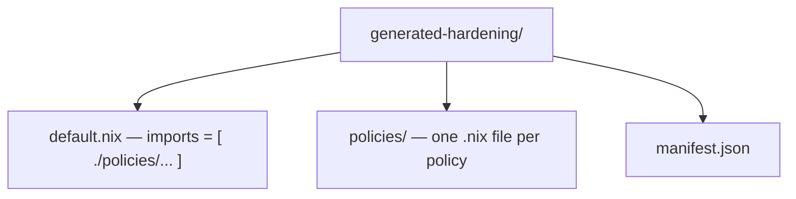

## Description

<!-- SECTION:DESCRIPTION:BEGIN -->
Add a Crystal Forge command-line binary that converts one or more exported Crystal Forge policies or compliance bundles into standalone NixOS modules.

The generated modules must be usable without a running Crystal Forge server: a user adds the generated files to an existing Nix flake, imports the module, and receives the NixOS configuration required to implement the selected Crystal Forge policies. The primary use case is bootstrapping a compliant NixOS configuration from policies that already exist in Crystal Forge.

Example scenario: a DevOps engineer must build a system that complies with a security baseline; their organization has no reusable NixOS hardening module, but another team already has the required controls implemented as Crystal Forge policies. The engineer obtains exported policies or an exported compliance bundle, passes them to this tool, imports the generated `.nix` files into an existing NixOS flake, and the generated module applies the policy implementations without requiring Crystal Forge at evaluation or deployment time.

## User story

As a DevOps engineer, I want to convert exported Crystal Forge policies or compliance bundles into standalone NixOS modules, so that I can quickly bootstrap a compliant NixOS system from existing policy implementations without first building a shared organizational hardening module or deploying the full Crystal Forge control plane.

## Goals

* Add a Crystal Forge CLI binary for NixOS module generation.
* Accept one or more exported policies and one or more exported compliance bundles; resolve the effective policy set from the inputs.
* Extract NixOS-compatible policy implementations and generate valid standalone NixOS module files importable into an arbitrary existing NixOS flake.
* Preserve enough policy metadata to identify the source policy and version.
* Produce deterministic output from identical inputs.
* Report policies that cannot be converted instead of silently omitting them.
* Work without a Crystal Forge server or database after the source artifacts have been exported.

## Proposed binary

Dedicated binary, preferred name `cf-nixos-module` (alternative names acceptable if repo naming conventions require). Example: `cf-nixos-module --input disa-stig-bundle.json --output ./generated-hardening`; multiple `--input` flags may be combined. The binary must not require a database or Crystal Forge API connection.

## Supported input

Consume the canonical Crystal Forge export formats rather than a generator-specific format. At minimum support the structured export format that preserves the complete policy implementation; if several formats have enough information, route them through the existing interchange parsing layer (packages/default/crates/cf-server/src/compliance/interchange.rs) instead of duplicate parsers.

Policy export -> one policy version. Compliance bundle export -> bundle version, bundle policy membership, referenced policy versions.

Multiple inputs may overlap. Deduplicate by stable policy/version identity. Identical duplicate definitions are acceptable. Conflicting definitions for the same immutable policy/version identity must fail with a clear error.

## Policy eligibility

Only generate when the exported policy has a NixOS implementation representable as a standalone NixOS module, e.g. `services.openssh.settings.PasswordAuthentication = false;` or other native NixOS option assignments already represented by the Crystal Forge policy model.

Never invent implementations for policies that contain only manual remediation instructions, external scanner checks, evidence collection, non-Nix implementations, unsupported remediation types, or compliance mappings without technical implementation. Such policies produce explicit diagnostics:

```text
V-230221 / require_physical_console_control  Reason: manual policy has no NixOS implementation
V-230482 / inspect_external_hardware         Reason: unsupported implementation type
```

A skipped policy must never be silently treated as implemented.

## Generated module structure

Single policy -> one module with comments carrying policy name, version identity, source, plus the Nix assignments. Multiple policies -> preferred layout:



The output must not require Crystal Forge-specific Nix modules unless those dependencies are explicitly included in the generated artifact; prefer ordinary NixOS module expressions depending only on standard NixOS module infrastructure.

## Bundle generation

Use the exact immutable exported bundle version's selected policy versions, never "latest": e.g. bundle B3 selects P1@4, P2@7, P3@2 and the output must not change when Crystal Forge later publishes newer versions.

## Compliance requirement metadata

Compliance mappings are metadata and must not change generated behavior. Preserve useful mapping info as comments or manifest metadata (e.g. `DISA NixOS STIG V1R1: V-268123`, `NIST 800-53 Rev 5: IA-5`). A single technical policy may map to multiple requirements; emit the implementation once, never duplicated per mapping.

## Conflict handling

Do not silently pick a winner when policies configure the same option differently. Report the conflict naming the option and both policy/version/value pairs. Use existing Crystal Forge policy-resolution semantics when they apply; do not introduce generator-specific resolution that disagrees with Crystal Forge deployment or evaluation behavior.

## Deterministic generation

Identical inputs + generator version -> identical content. Sort policy files and imports deterministically, use stable file names, no timestamps or random identifiers in generated Nix files, normalize serialized manifest output, stable formatting. Output must be committable to Git without unnecessary changes.

## Generated manifest

Machine-readable `manifest.json` with `format_version`, `generator`, per-policy `policy_id`, `policy_version_id`, `semantic_digest`, `generated_file`, and `skipped_policies`. For bundle inputs also include bundle identity, bundle version identity, bundle semantic digest, and source export digest when available. The manifest must make it possible to determine exactly which immutable Crystal Forge content generated the module.

## CLI behavior

Required: repeatable `--input <file>` and `--output <directory>`.

Useful options:
* `--check` — validate inputs can be converted without writing output.
* `--strict` — fail if any policy cannot be converted (default generates supported policies and reports unsupported ones).
* `--single-file` — optionally emit one combined module instead of the directory layout. Not mandatory for the first implementation if it significantly increases scope.

## Validation

Validate output with Nix. Automated tests must prove generated modules parse as Nix, evaluate as NixOS modules, and produce the expected NixOS option values. Prefer integration tests generating from known fixtures and evaluating through the NixOS module system:

```text
export fixture -> cf-nixos-module -> generated/default.nix -> NixOS module evaluation -> assert config values
```

Do not validate generated output only with string comparison.

## Library architecture

Do not put all generation logic in the CLI binary. Create reusable library layers: export parsing -> policy selection -> Nix implementation extraction -> conflict validation -> module model -> Nix serialization. The CLI handles arguments, file access, diagnostics, and output creation, so future server/web-UI workflows can reuse the generator without shelling out to the CLI.

## Security and trust requirements

Treat exported artifacts as untrusted input. Use the existing strict Crystal Forge export parsers where possible; verify immutable policy/version digests when supplied; reject malformed or inconsistent exported objects; reject duplicate immutable IDs with different content; avoid evaluating arbitrary Nix contained in an export merely to inspect it; avoid writing files outside the requested output directory; sanitize generated file names; fail clearly when an implementation cannot be safely serialized. Do not weaken Crystal Forge import validation to make module generation easier.

## Non-goals

No connecting to a running server; no automatic deployment of generated modules; no new compliance framework or bundle creation; no changing policy or bundle semantics; no generation for manual-only controls; no translating shell/Ansible/Puppet into Nix; no automatic conflict resolution; no maintaining generated modules after generation; no converting arbitrary NixOS config back into policies. A future task can add `--server ...` / `--bundle-id ...` to retrieve content directly from Crystal Forge.

## Example workflow

```bash
cf-nixos-module --input disa-nixos-stig-bundle.json --output ./stig-hardening
```

produces `stig-hardening/` with `default.nix`, `manifest.json`, and `policies/*.nix` (e.g. configure-auditd, disable-empty-passwords, require-ssh-key-auth, require-time-sync). A consumer flake imports `./stig-hardening` as one module. No Crystal Forge server is required after generation.
<!-- SECTION:DESCRIPTION:END -->

## Acceptance Criteria
<!-- AC:BEGIN -->
- [x] #1 A new Crystal Forge binary can generate a NixOS module from an exported Crystal Forge policy
- [x] #2 The binary can accept multiple policy exports
- [x] #3 The binary can accept an exported compliance bundle and generate modules for its selected policies
- [x] #4 Multiple inputs can be combined in one generation operation
- [x] #5 Duplicate policy versions are deduplicated deterministically
- [x] #6 Conflicting definitions for the same immutable identity are rejected
- [x] #7 Policies with supported NixOS implementations generate valid NixOS modules
- [x] #8 Manual-only and otherwise unsupported policies produce explicit diagnostics
- [x] #9 Unsupported policies are never silently represented as implemented
- [x] #10 Conflicting NixOS implementations are detected and reported
- [x] #11 Generated modules can be imported into an ordinary existing NixOS flake
- [x] #12 Generated modules do not require a running Crystal Forge server
- [x] #13 Generated modules preserve policy identity and version information
- [x] #14 Compliance mappings are preserved as metadata without duplicating technical implementations
- [x] #15 Bundle generation uses the exact immutable policy versions selected by the exported bundle version
- [x] #16 Generated output is deterministic
- [x] #17 A manifest records the exact policy and bundle versions used for generation
- [x] #18 Export digests are validated when present
- [x] #19 Generated Nix is tested through actual NixOS module evaluation
- [x] #20 Unit tests cover policy selection, deduplication, unsupported policy handling, and conflicts
- [x] #21 Integration tests cover policy export to generated module to NixOS evaluation
- [x] #22 Existing Crystal Forge interchange and policy-resolution semantics are reused rather than reimplemented with incompatible behavior
- [ ] #23 cargo fmt --all --check passes
- [x] #24 SQLX_OFFLINE=true cargo check passes for affected Rust packages
- [ ] #25 Relevant Nix builds and flake checks pass
<!-- AC:END -->

## Definition of Done
<!-- DOD:BEGIN -->
- [x] #1 A user can take a valid Crystal Forge policy or compliance-bundle export run one local command and commit or copy the generated module into an unrelated NixOS flake
- [x] #2 Importing the generated module yields the same supported NixOS configuration behavior represented by the exported Crystal Forge policy versions without a running Crystal Forge server
- [x] #3 The generated module is deterministic auditable standalone and explicit about any policy that could not be converted
<!-- DOD:END -->

## Implementation Plan

<!-- SECTION:PLAN:BEGIN -->
## Implementation plan (recorded before implementation)

### Corrections to task assumptions (verified against `dev` @ 350b6828)

1. `cf-server/src/compliance/interchange.rs` holds only frozen v0.1 identifier constants and `InterchangeLimits`. It contains **no** export parsers. Real policy-export parsing lives in private fns in `handlers/api/compliance.rs` (`normalize_policy_import`, `parse_policy_interchange_upload_with_source`, `validate_policy_interchange_document`); XCCDF parsing lives in `compliance/xccdf/`.
2. **There is no JSON compliance-bundle export.** Bundle versions export as XCCDF 1.2 XML only (`GET /api/v1/compliance/bundle-versions/:id/xccdf`). Policy exports are JSON/TOML (`urn:crystal-forge:policy-set:1`, and a bare single-policy object).
3. **No persisted field stores NixOS option assignments.** Policies store assertion expressions of the form `config.<path> <op> <literal>`. `compliance/xccdf/inference.rs` (`NixosOptionAssertionDraft`, `NixosLiteralValue`) and `exact_technical_match.rs` (`RequirementTechnicalIdentity { enforced_options }`) already encode the safe grammar for this and are unit-tested.
4. Declared dependency TASK-412 is still `In Progress`, but the server-side interchange work it covers is present in `dev`, so this task is unblocked in practice.

### Approved decisions (confirmed with user)

- **Architecture:** extract a new DB-free `cf-compliance` lib crate from `cf-server`; both `cf-server` and the new standalone `cf-nixos-module` binary crate depend on it. The binary has zero server/DB/HTTP dependency at build and run time. Chosen over duplication to satisfy AC #22.
- **Inputs:** policy-set/single-policy JSON and TOML, plus CF-native XCCDF 1.2 bundle XML.
- **Eligibility:** invert assertion expressions only. Accept `custom_check` rules whose expression is exactly `[cfg.]config.<option.path> == <bool|int|string literal>`. Do **not** infer from STIG `fix` prose.
- **`require_packages`:** skipped with an explicit diagnostic (package name is not a sound `pkgs` attribute path).

### Phases

1. **Extract `cf-compliance`** — move `canonical.rs`, `digest.rs` `*Canonical` DTOs, `interchange.rs`, and the DB-free parts of `compliance/xccdf/` (`models`, `parser`, `export_models`, `package`, `zip_extractor`, `inference`, `exact_technical_match`, `reconciliation`) into `packages/default/crates/cf-compliance`. Keep DB-bound code (`digest.rs` `write_*`, `resolver.rs`, `importer.rs` DB paths) in `cf-server`. Re-export from `cf-server` so no call sites change. Verify with `SQLX_OFFLINE=true cargo check`.
2. **Generator library** in `cf-nixos-module/src/lib.rs`, layered per the task: export parsing -> policy selection/dedup -> Nix implementation extraction -> conflict validation -> module model -> Nix serialization. Reuse `plan_policy_reconciliation` for identity/dedup/conflict semantics and `PolicyVersionCanonical::compute_digest` for digest verification (AC #18).
3. **CLI binary** `cf-nixos-module` with repeatable `--input`, `--output`, `--check`, `--strict`, `--single-file`. Diagnostics to stderr, deterministic output, sanitized file names, no writes outside `--output`.
4. **Nix packaging** — mirror the `cf-keygen` pattern in `packages/default/default.nix` (`mkWorkspaceSrc` / `mkComponentWorkspaceManifest` / `buildRustPackage` / `writeShellApplication`) and expose in `flake.nix`.
5. **Tests** — unit tests for selection, dedup, unsupported handling, conflicts, determinism, digest validation. A fixture-generator binary following the `xccdf-export-fixture` precedent. New `checks/nixos-module-generation/default.nix` that runs the generator over a fixture and evaluates the output through the NixOS module system (`lib.evalModules` / `nixosSystem`, per the `checks/stig` precedent), asserting real option values (AC #19, #21).

### Verification plan

- `cargo fmt --all --check`
- `SQLX_OFFLINE=true cargo check` for `cf-server`, `cf-compliance`, `cf-nixos-module`
- `SQLX_OFFLINE=true cargo test -p cf-compliance -p cf-nixos-module`
- `nix build .#packages.x86_64-linux.cf-nixos-module --no-link`
- `nix build .#checks.x86_64-linux.nixos-module-generation --no-link`
- `nix flake check --keep-going` (change touches the flake, packaging, and crate boundaries)

### Risks

- The `cf-compliance` extraction is the largest and riskiest part; it is a pure code move plus re-exports, verified by `cargo check` on unchanged `cf-server` call sites.
- Eligible-policy coverage depends entirely on how many real policies use the strict `config.<path> == <literal>` shape. If coverage is low, the honest outcome is many explicit skip diagnostics, not looser inference.

P2 remediation on commit 696707c8: (1) keep task status In Progress and replace stale notes with approved default-apply/explicit-disable semantics plus current commit verification; (2) add `publication_state` to each implemented policy entry in `manifest.json` from `ResolvedPolicy`, with a regression assertion; (3) replace the broad XCCDF publication-state mutation with a fixture where the bundle remains accepted and one selected policy is draft/interim, asserting generation rejects the selected policy lifecycle state; (4) rerun focused Rust/Nix checks and applicable server/Nix checks against current origin/dev, then commit and push without moving TASK-425 to Review.
<!-- SECTION:PLAN:END -->

## Implementation Notes

<!-- SECTION:NOTES:BEGIN -->
Current implementation: importing the three-file artifact applies the baseline by default; consumers can explicitly disable it. Rust owns compliance semantics; generated Nix applies typed assignments. Shared validation remains database-free, while Nix syntax checks use the packaged parser. Existing immutable identity/version-label checks and atomic directory writer are preserved.

Safety review remediation (code commit fc4f3d20): JSON/TOML exports now run the shared policy configuration validator before extraction, including rule metadata, strict types, and composite execution phase. The missing-field_name regression was observed failing before the fix and passes afterward for JSON and TOML; valid metadata still generates assignments. The manual fixture now uses the shared validator-valid empty-rule form and remains explicitly skipped. The public generation/rendering APIs normalize baselines consistently, with quote/control/Nix interpolation regressions. Baseline normalization is idempotent and bounded to 64 bytes. File reads are bounded before accumulation (plain JSON/TOML/XML 10 MiB; ZIP 50 MiB by content signature); metadata plus a capped read handle oversized/growing inputs. Byte-slice input is checked before XCCDF cloning. Sparse oversized JSON/TOML/XML/ZIP regressions prove existing output remains unchanged.

Actual local verification via nix develop: cf-compliance 329 library tests passed/1 ignored; generator 93 library, 8 CLI and 20 export integration tests passed; 1 doctest in each crate passed. Generator formatting and all-targets check passed. Nix builds passed for cf-nixos-module, its helper/generation package tests, and okf-knowledge (194 concepts, 216 Mermaid blocks, zero errors). Real NixOS module evaluation proves default application, explicit disable, determinism and provenance. No server, shared digest/interchange, writer, selection or CI configuration changes in this remediation.

The three behavioral DoD items are checked from local CLI/export/NixOS-evaluation evidence, not just pipeline status. AC23 remains unchecked because repository-wide formatting has pre-existing server.rs drift. AC25 remains unchecked because a complete full nix flake check was not yet established (earlier runs timed out). Task remains In Progress until required verification is reconciled; do not mark Done before merge and worktree removal. The previous head 8b95dd0d passed pipeline 3000323177. That historical green result does not establish CI for these new commits; record the exact new-head pipeline in the MR after pushing. No merge or deployment authorized.
<!-- SECTION:NOTES:END -->

## Comments

<!-- COMMENTS:BEGIN -->
author: OpenAI
created: 2026-08-23 20:26
---
User authorized implementation of MR review fixes: default-apply module behavior, reject mutable policy/bundle publication states, add manifest generated_file, make output regeneration history-independent, namespace default baselines with immutable bundle/version identity, rebase on latest origin/dev, and add discriminating regressions plus required verification.
---

author: OpenAI
created: 2026-08-23 20:27
---
Implementation preflight authorized: dedicated worktree TASK-425-cf-nixos-module, branch TASK-425-cf-nixos-module; scope is the five MR review findings and required regressions/verification. Rebase onto latest origin/dev before code changes.
---
<!-- COMMENTS:END -->
