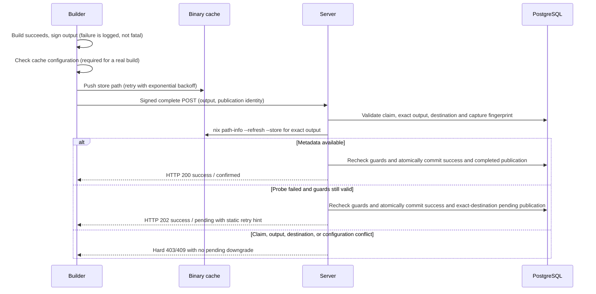

# Cache Push Process

The **builder** publishes a build output to the binary cache. The **server**
verifies the publication and records it. The record makes the artifact
deployable.

## Builder side

For a real (non-mock) build, the builder does these steps in order:

1. **Sign.** If a signing key is configured, the builder signs the output
   (`nix store sign --recursive`). A signing failure is logged and does not
   fail the job.
2. **Check the configuration.** The cache must be enabled for the target
   (`push_after_build` is true and the target name matches `push_filter`, if
   set), a push command must be derivable, and a cache reference must exist
   (`attic_cache_name` for Attic, `push_to` for the other types). If any is
   missing, the builder fails the job as a deterministic build-phase failure.
   The builder never reports a deployable build without a cache.
3. **Push with retry.** The push runs with a per-attempt timeout
   (`push_timeout_seconds`, default 3600). A failed attempt waits
   `retry_delay_seconds x 2^attempt` and tries again, up to `max_retries`
   retries. Some errors are terminal and are not retried: TLS and certificate
   errors, an unresolvable host name, and "no substituter that can build it".
   A final failure fails the job with the failure class that the error text
   gives. The job retry policy then decides whether to queue another attempt.
4. **Report.** The builder calls the complete route with the store path, cache
   reference, and selected destination ID. Niks3 requires its dispatch-bound ID.
   The updated client retries only completion POST reporting: at most five
   requests within ten minutes, each bounded to 90 seconds, with at least two
   seconds between requests. Fresh signatures/timestamps use the same payload
   and session. Reporting retries do not rebuild, re-sign, or reupload.

The builder checks for an operator cancellation before signing, before the
push, during the push, and before the completion report. A cancelled job does
not report success.

## Server side

The complete route (`POST /api/v1/builders/:id/jobs/:job_id/complete`) works
in this order:

1. It authenticates the signed request and validates builder/session ownership,
   job state, output, and eligible destination identity. Niks3 requires the exact
   dispatch-bound ID and server-authoritative output. It captures the mandatory
   publication configuration fingerprint before network work.
2. For a reported push, it runs `nix path-info --refresh --store <read-store>
   <exact-output>` with a 60-second metadata deadline **before completion commits**.
   Attic's read store is the canonical named-cache root; Niks3 uses its independent
   read plane. The probe checks root metadata availability only. It does not copy
   NARs, validate artifact signatures, traverse the closure, or create a fresh
   local Nix store. Configured keys and `require-sigs` settings do not make
   `path-info` full signature proof. Deployment, normal Nix substitution, and
   CVE materialization retain their separate signature/NAR-hash checks.
3. Both result paths transactionally recheck claim, exact output, selected
   destination, eligibility, and fingerprint. A successful probe atomically
   commits job/derivation success and completed publication, returning HTTP 200
   JSON `build_status: "success"`, `publication_status: "confirmed"`. A failed
   probe with valid guards atomically commits build success and an exact-destination
   pending `cache_push_jobs` row, returning HTTP 202 JSON with publication `pending`.
   It creates no confirmed publication and retains the GC root and log channel.
   Bad identity/output, stale configuration, lease/session mismatch, and cancelled
   work remain hard 403/409 failures; they cannot become pending success.
4. Matching same-builder/session callbacks can promote the existing row while
   the build remains `success`, without duplicate build jobs or scan admission.
   Confirmed publication promotes scans waiting for publication and releases the
   recovery GC root best-effort. Failed probes never demote historical completed
   evidence. Completion without a reported push returns HTTP 200 success / `none`.

The 202 response carries a static `verification_code` and `retryable` flag.
`cache_path_missing`, `cache_rate_limited`, `cache_network_error`, and
`cache_probe_timeout` are retryable and include `retry_after_secs: 2`.
`cache_authentication_failed`, `cache_read_configuration_invalid`, and
`cache_probe_failed` are non-retryable. Read credentials remain protected through
child kill/reap; Basic keeps the native exact-HTTPS-authority guard and no redirects.
Private stdout/stderr are each bounded to 64 KiB. Logs contain cache ID, allowlisted
type, path-info stage, elapsed time, and static outcomes, not URLs or provider text.

An acknowledged pending receipt proves durable build success even if subsequent
reporting fails. Without an acknowledgement, network failure leaves server state
unknown. There is no durable builder callback replay after restart, and the queue
does not guarantee automatic worker startup. After correction, an operator must
arrange a signed same-claim callback replay, preserving payload/session and all
fingerprint guards. Recover `cache_pending` publication rather than Retry Build.
See [Niks3 publication recovery](niks3-cache.md#publication-failure-and-recovery).

A derivation is deployable only with a `completed` row whose `store_path`
equals `derivations.store_path`. See
[Store path flow](../workflows/store-path-flow.md).

### Completion without a builder-side push

If a completion reports no push, build success does not imply publication.
A persisted dispatch destination can queue that exact identity atomically;
unbound legacy/static work uses canonical eligibility resolution. A recorded
no-cache dispatch must not be reinterpreted as a newly configured destination.
Queue insertion does not guarantee that a worker starts. Such an artifact stays
undeployable until publication evidence for the exact store path is `completed`.

## Cache types

| Type | Push command | Reference the builder reports |
| --- | --- | --- |
| `nix` | `nix copy` to the `push_to` store URL | `push_to` |
| `http` | `nix copy` to the `push_to` store URL | `push_to` |
| `s3` | `nix copy --to <push_to>`, with S3 options (region, profile, endpoint, credentials) | `push_to` |
| `attic` | `attic push <cache name> <store path>` with token authentication | `attic_cache_name` |
| `niks3` | One packaged `niks3 push` process with protected write credentials | Independent read URL plus mandatory dispatch-bound destination ID |

## Cache configuration

| Setting | Meaning |
| --- | --- |
| `push_after_build` | Enables pushing. Without it, a real build fails the cache check. |
| `push_filter` | Pushes only a target whose name contains one of these strings |
| `signing_key` | Key file for the signing step |
| `parallel_uploads` | Concurrent uploads (default 1) |
| `compression` | Passed to `nix copy` as `--compression` |
| `force_repush` | Adds a refresh flag so an existing path is pushed again |
| `push_timeout_seconds` | Timeout of one push attempt (default 3600) |
| `max_retries`, `retry_delay_seconds` | Retry count and the base of the backoff |

## The `cache_push_jobs` table

- One row records one cache publication of one derivation and store path.
- Columns include the status, attempt count, push size, push duration, and
  error text. Statuses include `pending`, `in_progress`, `completed`, and
  `failed`.
- The row is separate from the derivation status.
- Operators can list, inspect, retry, and cancel rows through
  `/api/v1/cache-push-jobs` and its bulk routes. Retrying a row does not push
  anything by itself. No started server task consumes pending rows.

## Server-side cache worker (not started)

The `cf-server` library contains a server-side cache worker
(`builder/cache_worker.rs`: `run_cache_push_workers`, `run_cache_push_loop`,
`process_cache_pushes`). It claims pending `cache_push_jobs` rows and pushes
with exponential backoff. `spawn_background_tasks` does not start it, and no
other caller exists. It is a retirement candidate. See the
[cleanup record](../meta/cleanup-record.md).

## Related concepts

- [Server background tasks and builder work loops](../architecture/derivation-processing-loops.md) - which loops run
- [Derivation status lifecycle](../concepts/derivation-status-lifecycle.md) - the cache-pushed status
- [Commit to deploy sequence](../workflows/commit-eval-build-cache-deploy-sequence.md) - the whole pipeline in order
- [S3 cache (MinIO) quickstart](s3-minio-cache-quickstart.md) - an S3 example
