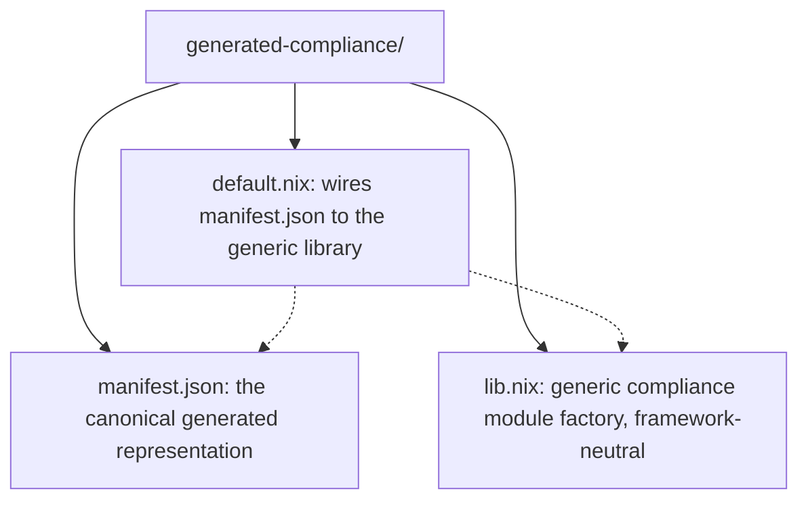

# Generating Standalone NixOS Modules (`cf-nixos-module`)

`cf-nixos-module` converts exported Crystal Forge policies and compliance
bundles into ordinary NixOS modules that you can import into any existing flake.

The generated module depends only on standard NixOS module infrastructure. Once
generated, **no Crystal Forge server, database, or agent is required** at
evaluation or deployment time.

## Building and running

Policy JSON/TOML and CF-native bundle validation share the server's full policy
configuration validator. Required rule metadata, Boolean `strict` values, and
configuration shape are checked before extraction. An otherwise convertible
assertion cannot bypass an invalid configuration. Custom
expressions require `nix-instantiate` on `PATH` for a bounded syntax-only parse;
they are not evaluated. The Nix package wrapper supplies that executable. When
running a Cargo-built binary directly, use the repository development shell or
provide Nix on `PATH`. No server connection or database is required.

The CLI bounds file reads before accumulating the input: plain JSON, TOML and
XML documents are limited to 10 MiB, and ZIP packages to 50 MiB. ZIP content
signatures, not filenames, select the archive limit. These reuse the shared
interchange plain-document and archive bounds. The library byte-slice loader
also checks size before parsing or cloning XCCDF input. Oversized input fails
before any output is published.

```bash
nix build .#cf-nixos-module
./result/bin/cf-nixos-module --input policy-set.json --output ./stig-hardening

# or without installing
nix run .#cf-nixos-module -- --input policy-set.json --output ./stig-hardening
```

The package retains its Nix helper and generated-module evaluation tests:

```bash
nix build .#cf-nixos-module.tests.helper .#cf-nixos-module.tests.generation -L
```

### Options

| Flag | Meaning |
| --- | --- |
| `-i`, `--input <FILE>` | An exported artifact. Repeatable. Required. |
| `-o`, `--output <DIR>` | Output directory. Required unless `--check`. |
| `--check` | Validate the inputs and report results without writing output. |
| `--strict` | Exit non-zero if any policy could not be converted. |
| `--baseline <NAME>` | Identifier for the generated baseline. Defaults to the bundle name plus immutable bundle-version ID, or the lexicographically first input's file stem. |

Baseline names are normalized to safe lowercase ASCII identifiers of at most
64 bytes. The public generation and rendering APIs apply the same normalization
as the CLI, so quotes, control characters, or Nix syntax cannot enter generated
source through a baseline name. The returned identifier, module and manifest
use the same normalized value.

## Supported inputs

| Export | How to obtain it | Contributes |
| --- | --- | --- |
| Policy set (`.json` / `.toml`) | `POST /api/v1/policies/interchange/export`, or the Policies page **Export** actions | One or more policy versions |
| Single policy (`.json` / `.toml`) | `GET /api/v1/policy-versions/:version_id/export?format=json\|toml` | One policy version |
| CF-native compliance bundle (`.xml` / `.zip`) | `GET /api/v1/compliance/bundle-versions/:version_id/xccdf` | A bundle version, its frozen membership, and the referenced policy versions |

Foreign STIG or third-party XCCDF documents are **not** accepted directly.
Import them into Crystal Forge first (see
[CF-XCCDF Compliance Interchange Operator Guide](cf-xccdf-interchange-operator-guide.md)), then export the
resulting bundle version.

Multiple inputs can be combined in one run. Identical duplicate definitions are
collapsed. Two inputs that define the *same* immutable policy version with
*different* content are rejected.

A policy version UUID has one lineage across all inputs, not one per document.
Exports that claim the same version UUID for different lineages are rejected.
If duplicate policy or bundle versions disagree about `publication_state`
(`accepted` versus `deprecated`), generation also fails. Lifecycle state is not
part of the semantic digest, but is emitted in the manifest. Differing human-
readable `version` labels on duplicate policy or bundle versions are rejected
for the same reason. Diagnostics name the immutable version UUID and both
labels in sorted order. Rejecting these disagreements prevents input order
from choosing the manifest's metadata.
Obtain consistent exports before trying again.

## Output layout



There is no per-policy `.nix` file. Every policy's implementation is normalized
data in `manifest.json`; `lib.nix` turns that data into NixOS option
definitions.

## Consuming the artifact

Importing the artifact applies the baseline by default. You may explicitly
disable it when needed:

```nix
{
  outputs = { nixpkgs, ... }: {
    nixosConfigurations.web01 = nixpkgs.lib.nixosSystem {
      system = "x86_64-linux";
      modules = [
        ./hardware-configuration.nix
        ./generated-compliance          # <- generated by cf-nixos-module

        # Optional: the imported baseline is enabled by default.
        { crystal-forge.compliance.production-baseline.enable = false; }
      ];
    };
  };
}
```

Read-only provenance is available at evaluation time:

```nix
config.crystal-forge.compliance.production-baseline.summary
# { generator, formatVersion, policyCount, assignmentCount,
#   policyVersionIds, bundles, skippedPolicyCount }
```

### There are no per-policy switches

Enabling a baseline applies every policy the resolved export selected. If a
bundle contains 150 policies, all 150 apply. Local Nix configuration cannot
remove a policy from the baseline.

Exceptions, waivers, and deviations belong in Crystal Forge's compliance model,
where they are reviewable and auditable, and they are reflected in the exported
content. The generated module deliberately does not implement a second
compliance-record system.

### Conflicts with local configuration are surfaced, not hidden

Generated definitions are ordinary NixOS definitions. If your configuration sets
the opposite value:

```nix
crystal-forge.compliance.production-baseline.enable = true;
services.openssh.settings.PasswordAuthentication = true;   # baseline says false
```

NixOS reports a normal conflicting-definition error. That is intended: it tells
you your local configuration contradicts the compliance baseline. The generator
does not use `mkForce` or any other override priority to paper over it.

## Which policies can be converted

A policy is converted only when it already expresses declarative NixOS option
state. Concretely, the policy must be:

* `implementation_state = native`; and
* `policy_type = custom_check`; and
* every one of its rule expressions must be exactly
  `config.<option.path> == <literal>` (or the equivalent `cfg.config.` form),
  where `<literal>` is `true`, `false`, a non-negative integer, or a
  double-quoted string without interpolation; and
* `mode` must be `all`, because an `any`-mode check does not determine a single
  configuration.

The export must also prove lifecycle immutability: direct policy exports must be
`accepted` or `deprecated`, every policy selected by a bundle must be `accepted`
or `deprecated`, and the bundle version itself must be `accepted`. Draft,
incomplete, and interim content is rejected before generation.

Everything else is reported and skipped. **The tool never invents an
implementation** from prose, fix text, shell commands, or compliance mappings.

Commonly skipped cases:

| Reason code | Example |
| --- | --- |
| `not_native` | `manual`, `external`, `unbound`, or `opaque` policies |
| `unsupported_policy_type` | `require_cve_check`, `time_window`, `require_approvals`, `canary_rollout`, `cve_threshold`, `require_cf_agent`, `require_packages` |
| `unrepresentable_expression` | `builtins.length config.security.audit.rules > 0` |
| `ambiguous_rule_mode` | a multi-rule check with `mode = "any"` |
| `self_contradictory` | one policy asserting an option is both `true` and `false` |

`require_packages` is skipped deliberately: it stores bare package *names*,
which are not reliable `pkgs` attribute paths, so emitting
`environment.systemPackages` could produce a module that does not evaluate.

Skipped policies are printed to stderr and recorded in `manifest.json` under
`skipped_policies`. They are never represented as implemented. Use `--strict` in
CI when you need every policy to convert.

## Conflicts

The tool never picks a winner. Each of these aborts generation with a non-zero
exit code.

| Code | Meaning |
| --- | --- |
| `CF_EFFECTIVE_POLICY_VERSION_CONFLICT` | One policy lineage is selected at two different versions. Crystal Forge resolves at most one version per lineage, so this is ambiguous even when the two versions touch unrelated options. |
| `CF_POLICY_VERSION_DIGEST_CONFLICT` | The same immutable `version_id` is defined with two different semantic digests. |
| `CF_BUNDLE_VERSION_IDENTITY_CONFLICT` | The same immutable `bundle_version_id` is defined with different content or membership. |
| (option conflict) | Two different policies assign the same NixOS option different values. Reported with the option path and both policy/value pairs. |

Effective-set resolution uses the same authoritative lineage/version rule as the
Crystal Forge server's resolver, so this tool cannot accept a combination the
server would reject.

## The manifest is the canonical representation

`manifest.json` serves both audit/provenance and module construction. It is
data only — never Nix source.

```json
{
  "format_version": "2",
  "generator": "cf-nixos-module 0.3.0",
  "baseline": "production-baseline",
  "bundles": [ { "bundle_id": "...", "bundle_version_id": "...", "semantic_digest": "..." } ],
  "policies": [
    {
      "policy_id": "...",
      "policy_version_id": "...",
      "publication_state": "accepted",
      "semantic_digest": "...",
      "generated_file": "manifest.json",
      "source_inputs": ["bundle.xml"],
      "source_export_digests": ["..."],
      "compliance_mappings": ["NIST 800-53 Rev 5: IA-5"],
      "assignments": [
        {
          "path": ["services", "openssh", "settings", "PasswordAuthentication"],
          "value": false
        }
      ]
    }
  ],
  "skipped_policies": [ { "name": "...", "reason_code": "...", "reason": "..." } ]
}
```

`path` is an array of components and `value` is typed JSON (boolean, integer,
string, list, object, or null). Nix expressions are never serialized as strings
and never evaluated. A manifest value that looks like Nix source — for example
`"builtins.readFile /etc/passwd"` — is applied as a literal string.

Compliance mappings are metadata. A policy that maps to DISA, NIST, CIS, and
CMMC requirements still has exactly one implementation representation.

## Determinism

Identical inputs and generator version produce byte-identical output, and
reordering equivalent inputs on the command line changes nothing: ordering and
provenance are content-derived, and nothing embeds a timestamp or random
identifier. When the same immutable policy appears in several inputs, every
origin is retained in sorted order rather than whichever input came first.

Generated output is safe to commit.

## Trust boundary

Crystal Forge (Rust) is the source of truth for policy semantics. Nix is only
the deployment mechanism for already-validated configuration.

Before any assignment reaches `manifest.json`, the Rust generator has
established that the export is valid, the immutable identity is valid, the
policy version is the selected one, the assertion is supported, it maps to an
exact option path and typed value, and it does not conflict with the resolved
set.

`lib.nix` therefore does nothing but `path + typed value -> option definition`.
It never parses assertions, resolves versions, or evaluates policy source.

Exported artifacts are treated as untrusted input:

* parsing reuses the server's strict interchange parsers, with DTDs, external
  entities, network retrieval, and archive attacks disabled;
* every supplied semantic digest is recomputed and verified, for both policy
  documents and CF-native bundles;
* Nix contained in an export is never evaluated in order to inspect it;
* existing output files are never opened for writing. The writer creates fresh
  files and publishes a complete generation by directory rename. Symlinks at
  the final output name or inside an existing artifact are rejected; external
  hardlinks retain their original contents;
* for a ZIP input, `source_export_digests` identifies the archive the user
  supplied, not just the XML member selected from it.

### Atomic publication and output ownership

`--output` names a dedicated generator-owned directory. An existing directory
may contain only regular files named `default.nix`, `lib.nix`, and
`manifest.json`; incomplete or empty directories are permitted. Unrelated
entries, including the old `policies/` layout, are rejected without changing
the artifact. Keep consumer files outside this directory.

The generator stages and validates all three files in a private temporary
sibling on the same filesystem. Initial publication renames that directory
into place with an absence guard. Regeneration uses Linux
`renameat2(RENAME_EXCHANGE)`, which publishes the complete directory in one
operation. Unsupported atomic exchange fails without changing the existing
artifact; there is no sequential-write or rollback fallback.

The parent directory must allow sibling creation and renaming. Output paths
such as `.`, `..`, `/`, or mount points that cannot be replaced are unsupported.
Parent path symlinks are intentionally followed. Existing output directory
access bits are retained; new output uses mode `0755`. Ownership, ACLs, and
special mode bits are not copied to the replacement directory.

Handled failures before publication leave the original artifact unchanged.
Temporary siblings are cleaned after success or handled failure. If cleanup
fails after publication, the error explicitly states that the new artifact is
already published and names the retained temporary sibling. Abrupt process
termination can also leave a temporary sibling. Do not concurrently rename or
edit the output or staging directories during generation. Atomic publication
does not promise power-loss durability or a snapshot for readers that open
different files across the directory exchange.

Because bundle generation uses the exact policy versions the exported bundle
version froze, output does not change when Crystal Forge later publishes newer
versions of those policies.
