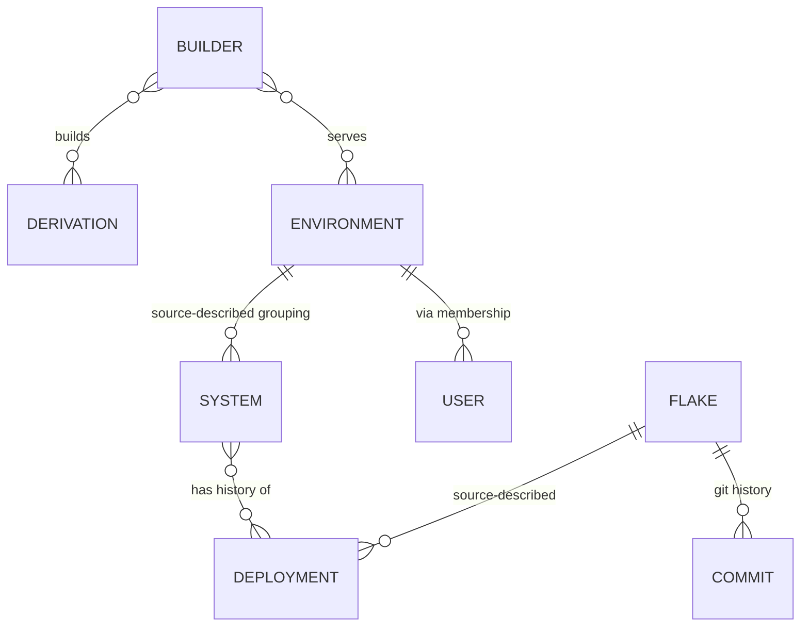

# Data Model

## Core Entities

| Entity | Description |
|--------|-------------|
| **System** | Registration of a managed machine, external machine, or reference configuration; UUID identity is separate from configuration identity |
| **Environment** | Grouping for systems (prod, staging, dev) |
| **Flake** | A Nix flake registry entry (git repo + branch) |
| **Builder** | Worker that builds derivations |
| **User** | Admin/Operator/Viewer accounts |
| **Deployment** | Record of a system being deployed |
| **Derivation** | A Nix derivation being built |
| **Cache** | Binary cache for built derivations |

`management_mode` defaults existing registrations to managed. Nonmanaged rows
have null enrollment keys and desired targets. Only external rows can have a
parent association. Several registrations can share one flake/configuration;
the registration UUID is not an artifact owner. Signed parent observations are
append-only evidence separate from `system_states` and scan authority. See
[management modes and configuration assurance](../concepts/management-modes-and-configuration-assurance.md)
for migrations `0311`, `0312`, `0314`–`0320` and pending integration proof.

`systems.agent_enrolled_at` is nullable and database-owned. Migration `0318`
stamps nonmanaged-to-managed conversion after row-lock acquisition; existing
managed null epochs retain legacy semantics. Raw states remain history while
`view_agent_current_system_states` filters active managed observations to the
current enrollment. Migration `0320` keeps mode/epoch-filtered inactive managed
detail telemetry without restoring active-only Current authority.

Migration `0319` adds non-null `tags text[] DEFAULT '{}'` and nullable
`description`. These are registration metadata in every mode, not runtime
observations. Managed registration persists address and reachability through
the existing columns. Config sync preserves operator metadata and the enrollment
epoch. PATCH omission/clear rules are specified in the [Systems API](../api/systems-api.md).

## Relationships

> The diagram encodes the source document's conceptual relationship sketch.
> Its cardinality notation is not derived from migrations and MUST NOT be read
> as a statement of current database constraints.

## Related concepts

- [System overview](../overview/system-overview.md) - product orientation
- [Derivation status lifecycle](../concepts/derivation-status-lifecycle.md) - states of the derivation entity
