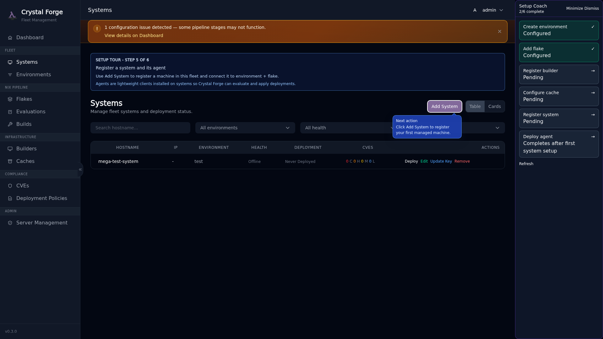
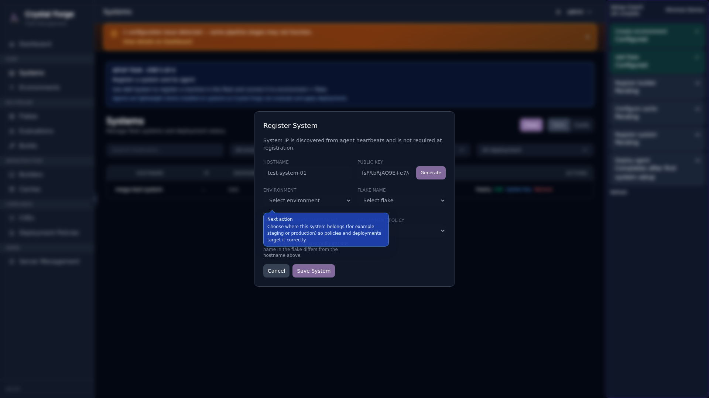
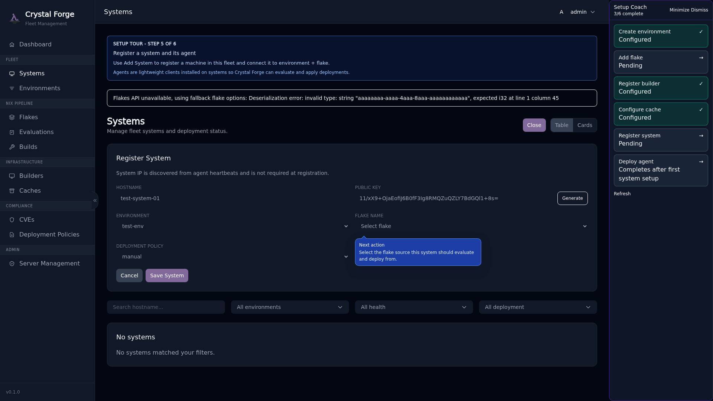
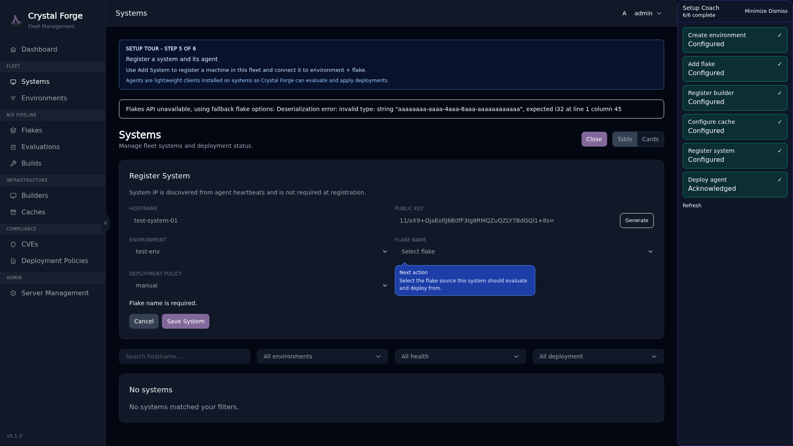

# Step 5: Register System

**Systems** are registered resources: managed machines, externally deployed
machines, or reference configurations. Only managed machines enroll with an
Ed25519 key. TASK-508 backend and UI changes are present in source; final browser
and owning integration verification remain pending. See
[management modes and configuration assurance](../concepts/management-modes-and-configuration-assurance.md)
for artifact admission, neutral unknown health and remaining integration proof.

## Why Systems Matter

- **Fleet Tracking**: Monitor which configurations are deployed where
- **Deployment Control**: Apply updates based on policy (manual, auto, pinned)
- **Compliance Monitoring**: Track STIG controls and CVE exposure per system
- **Agent Telemetry**: Receive system fingerprints, heartbeats, and state changes

## Systems page and retained onboarding images

Click the "Register system" step in the coach panel.

These screenshots show the earlier managed-only coach. They are historical
onboarding illustrations, not evidence of management-mode UI parity. Agent
state reporting, deployment instructions and activations apply only to managed
machines. External/reference resources need no agent enrollment.

Click **Add System** to open the registration modal.

## Guided Tour: Add System Form

Choose the management mode before entering enrollment or configuration details.

**Fill in:**

- **Management mode**: `managed`, `external`, or `reference`.
- **Resource name (`hostname`)**: Unique machine identity for managed/external;
  descriptive name for reference (for example, `Golden workstation baseline`).
- **Public Key**: Valid Ed25519 public key for managed only. Omit the key for
  external/reference; do not generate a placeholder key.
- **Environment**: Which environment this system belongs to
- **Flake and configuration**: External/reference require a registered flake and
  explicit `system_configuration_name`. Several unique registrations can use
  the same configuration.
- **Parent host**: Optional for external only; must be an active managed host in
  the same environment. This permits unit observations, not guest deployment.
- **Deployment Policy**: Managed deployment behavior, independent of mode.
- **Tags and description/notes**: Persisted operator metadata in every mode.
  Tags have fleet suggestions and appear as chips and filter choices.
- **Address and reachability**: Managed registration persists optional FQDN/IP
  and `direct` or `pull` reachability. Config sync preserves these values.

The configuration selector and Flake Explorer's **Add to Forge** use exact
Native declaration inventory even when the optional full module/input snapshot
is absent. Unknown declaration discovery cannot validate free text. Missing
Modules/Inputs remain unavailable, not known-empty collections.

### Generating a Key Pair

For a managed system without an Ed25519 key pair, use **Generate Key Pair** in
the form. The UI displays both keys; the server stores the enrollment public key.
External and reference registrations do not use this step.

**Save the private key** — you'll need it on the target system. The public key is automatically filled into the form.

### How Deployment Policies Work

The system's stored deployment policy applies only when mode grants deployment
authority. Initial external/reference-to-managed conversion requires a new valid
key and explicit `manual` policy and queues no deploy. A later explicit edit can
enable `auto_latest` or `pinned`.

- **manual**: An admin must explicitly approve deployments (safest for production)
- **auto_latest**: Automatically deploy the newest eligible cached derivation for this system configuration across commits of its registered flake. Newer failed or pending commits do not make the deployed system behind; a newer deployable derivation does.
- **pinned**: Deploy a specific commit/derivation (useful for canary deployments)

## System Creation Success

After creating your first system, the server reports **Step 5** complete. The agent step remains incomplete until the first signed report arrives and an Administrator acknowledges it.

## Related concepts

- [Onboarding guide: first-time server setup prerequisites](onboarding-first-time-setup-prerequisites.md)
- [Guided setup coach, POA&M dashboard notes, and security workflows track](../ui/guided-setup-coach.md)
- [Onboarding troubleshooting](onboarding-troubleshooting.md)
- [Step 4: Configure Cache](onboarding-step-4-cache-destinations.md)
- [Step 6: Deploy Agent](onboarding-step-6-agent-deployment.md)
