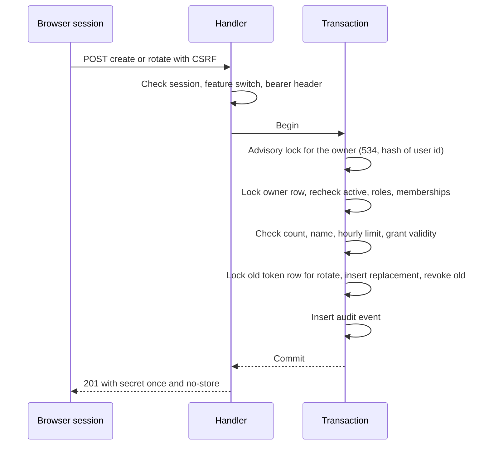

# Owner access token service

## Status and authority

TASK-534.3 implements the owner slice of milestone M1 in
[CF-AGENT-ACCESS-001 v1.1](agent-access-tokens-mcp-remediation-context.md).
A signed-in Viewer, Operator or Admin can issue, list, inspect, rotate and
revoke their own `cfat_v1_` access token from Profile. The implementation sits on
the M0 boundary described in
[credential grant boundaries](credential-grant-groundwork.md).

This concept describes implemented code. It does not describe verified
behavior: farm results for the exact head are recorded in the task, not here.

Not implemented in this slice:

- The MCP transport, the `/mcp` route and every MCP tool. Nothing accepts a
  `cfat_` credential yet, so an issued token is inert. The policy endpoint reports
  `mcp.enabled = false` until milestone M2.
- The Admin Access Tokens tab, admin revoke and revoke-all endpoints, the MCP
  status card and the Access Inspector.
- The Connect agent shortcut on Fleet CVEs and POA&M views.
- Write and operational scopes. Only `cves:read`, `poams:read` and
  `provenance:read` can be selected. The other scopes appear as unavailable.
- A throttled `last_used_at` writer in a request path. The query helper exists;
  no request path calls it before M2.

## Contract

All endpoints are under `/api/v1`. Every response, including errors, carries
`Cache-Control: no-store`. No endpoint requires the Admin role.

| Method | Path | Behavior |
| --- | --- | --- |
| GET | `/user/access-token-policy` | Selectable environments and scopes, lifetime options, limits, `create_blocked` |
| GET | `/user/access-tokens` | Own tokens, newest first; filters `status` and `q`; `limit` and `offset` |
| POST | `/user/access-tokens` | Creates a token; the response carries the secret once in `token` |
| GET | `/user/access-tokens/:id` | Metadata, granted versus current effective access, recent audit events |
| DELETE | `/user/access-tokens/:id` | Revokes; idempotent |
| POST | `/user/access-tokens/:id/rotate` | Replaces an active token; the response carries the new secret once |

Authentication is a browser session. POST and DELETE also require CSRF. A
request that carries an `Authorization: Bearer cfat_...` header is never
authenticated by that header. Another user's token returns `404
resource_not_found`.

Errors use `{"error", "message", "details"}`. `validation_failed` (400) lists
field messages in `details.fields`. Other codes are `unauthorized`, `forbidden`,
`access_tokens_disabled`, `resource_not_found`, `conflict` and `rate_limited`.

## Token format and storage

The token is `cfat_v1_<32 lowercase hex id>_<43 character base64url secret>`.
The id is the token row UUID. The secret is 256 bits from the operating system
random generator.

The database stores the SHA-256 hash of the complete token and a display hint
(`cfat_v1_` and four hex characters). It does not store the secret. The audit
event metadata, list responses and detail responses never contain the secret or
the hash. A lost secret cannot be recovered; the owner issues a replacement.

Grants are immutable. Scopes, environments, audience and expiry never change
after issuance.

## Limits

| Limit | Value |
| --- | --- |
| Name length | 1 to 100 characters, unique per owner among non-revoked tokens, ignoring case |
| Live tokens per owner | 20 (not revoked, not expired) |
| Environments per token | 50 |
| Create plus rotate operations per owner per hour | 10, counted from `created_at`; exceeding returns 429 |
| Lifetime | 1 day up to the configured maximum (default 30, maximum 90 days) |

Create never narrows a request. It rejects unknown, inactive, duplicate or
unassigned environments and unavailable or duplicate scopes. An Admin must
still list concrete environment ids. No wildcard exists.

An expired token that is not revoked keeps its name until the owner revokes it,
because name uniqueness follows revocation and not expiry.

## Serialization and ordering

The owner advisory lock uses a key namespace separate from the administrator
grant lock `(526, 2)`. Lock order is the owner advisory lock, then the owner
row, then token rows. Create and rotate read role and membership state inside
the transaction. They never use values captured before the transaction.

Revoke locks the token row. A rotation that races a revocation or another
rotation of the same token has one winner. A failed rotate changes nothing and
leaves the old token active.

## Rotation

Rotation applies only to an active token. It revalidates the same grant against
the owner's current role and assignments. If the grant is no longer permitted,
the request returns 409 and the old token stays active. The replacement keeps
name, audience, scopes and environments. It expires after the original lifetime,
reduced to the current maximum when needed. The old token is revoked in the same
transaction.

## Audit

Create, rotate and revoke write `access_token_created`, `access_token_rotated`
and `access_token_revoked` to `admin_audit_events` in the same transaction as the
change. The target is the public token id. Metadata holds the name, scopes,
environment ids and expiry. The Admin Audit Log lists these events.

## Validation for future bearer admission

`validate_presented_token` is the server function that milestone M2 calls. It
parses the bounded token format, finds the row by public id, compares the hash
in constant time, and requires an unrevoked, unexpired token and an active
owner. It returns a `RestrictedGrant` for the M0 boundary together with the owner
id. Every failure returns the same non-disclosing error.

An owner is OIDC-owned when an external identity row exists for the user. Such an
owner also needs fresh, resolved entitlements under the M0 freshness rule and the
configured maximum age. Create and rotate apply the same rule and report the
reason in `create_blocked`. Local accounts are exempt.

The returned grant is bounded by the owner's current role and environments at
request time. A role promotion never widens a token.

## Configuration

`services.crystal-forge.server.accessTokens` has `enable` (default true),
`defaultLifetimeDays` (30) and `maxLifetimeDays` (90). Startup rejects a default
below 1, a default above the maximum, or a maximum above 90. With `enable`
false, create, list, detail and rotate return 403 `access_tokens_disabled`. The
policy endpoint still answers and revoke stays available.

## Related concepts

- [Credential grant boundaries](credential-grant-groundwork.md)
- [OIDC entitlement ownership](oidc-entitlement-ownership.md)
- [Agent access tokens, MCP and remediation context](agent-access-tokens-mcp-remediation-context.md)
