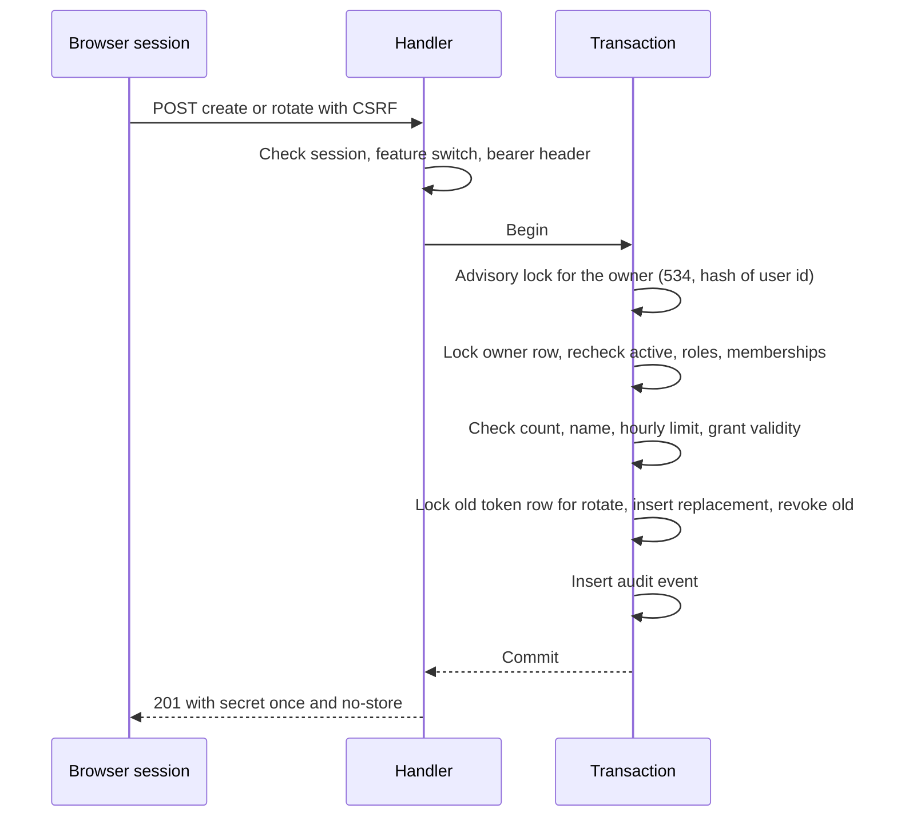

# Owner access token service

## Status and authority

TASK-534.3 implements the owner slice of milestone M1 in
[CF-AGENT-ACCESS-001 v1.1](agent-access-tokens-mcp-remediation-context.md).
A signed-in Viewer, Operator or Admin can issue, list, inspect, rotate and
revoke their own `cfat_v1_` access token from Profile. The implementation sits on
the M0 boundary described in
[credential grant boundaries](credential-grant-groundwork.md).

This concept describes implemented code. It does not describe verified
behavior: farm results for the exact head are recorded in the task, not here.

TASK-534.4 adds the only consumer: the opt-in [MCP server](mcp-server.md) at
`POST /mcp`. It admits tokens through `validate_presented_token` and writes
`last_used_at` at most once per 5 minutes per token. While `mcp_enable` is
`false`, nothing accepts a `cfat_` credential and the policy endpoint reports
`mcp.enabled = false`; when it is `true`, the policy reports
`mcp.enabled = true` and `mcp.url` from `mcp_public_url`.

Not implemented in this slice:

- The Admin Access Tokens tab, admin revoke and revoke-all endpoints and the
  Access Inspector.
- The Connect agent shortcut on Fleet CVEs and POA&M views.
- `poams:close`. TASK-534.5 released `scans:request`, `poams:write` and
  `poams:verify` for Operator and Admin owners; Viewers see "Requires
  Operator". A write scope together with a production environment needs
  `confirm_production_write: true` in the create request (400
  `validation_failed`, field `confirm_production_write`, otherwise). Rotation
  keeps the original grant. See [MCP server](mcp-server.md#write-tools).

## Contract

All endpoints are under `/api/v1`. Every response that these handlers build,
including their error responses, carries `Cache-Control: no-store`. Responses
that the framework builds do not carry it: extractor rejections (for example an
unreadable request body) and router 404 and 405 responses. No secret appears in
those responses. A secret appears only in the 201 response of a successful
create or rotate. No endpoint requires the Admin role.

| Method | Path | Behavior |
| --- | --- | --- |
| GET | `/user/access-token-policy` | Selectable environments and scopes, lifetime options, limits, `create_blocked` |
| GET | `/user/access-tokens` | Own tokens, newest first; filters `status` and `q`; `limit` and `offset` |
| POST | `/user/access-tokens` | Creates a token; the response carries the secret once in `token` |
| GET | `/user/access-tokens/:id` | Metadata, granted versus current effective access, recent audit events |
| DELETE | `/user/access-tokens/:id` | Revokes; idempotent |
| POST | `/user/access-tokens/:id/rotate` | Replaces an active token; the response carries the new secret once |

Authentication is a browser session. POST and DELETE also require CSRF. A
request that carries an `Authorization` header with a `cfat_` credential is
never authenticated by that header, and the request returns 401 even when it
also carries a session cookie. Detection splits the value on ASCII whitespace,
ignores letter case, and treats a value that is not visible ASCII as presented.
Another user's token returns `404 resource_not_found`.

The list filter `q` must not contain a control character (including NUL); the
endpoint returns 400 `validation_failed` with `details.fields.q`.

Environment entries in the policy (`environments[]`: `id`, `name`, `color`) and
in token metadata (`environments[]`: `id`, `name`, `is_active`, `color`) carry
`color`. The server returns `color` only when `environments.color_hex` is
exactly `#RRGGBB` (three hex pairs, either letter case). Any other stored value
returns `null`. The response never contains arbitrary stored text.

The policy also carries `oidc_owned` and `entitlement_max_age_hours`.
`oidc_owned` is `true` when the owner has any `external_identities` row. This is
the same test that `create_blocked` uses, and the policy reports it when tokens
are disabled. When `oidc_owned` is `true`, `entitlement_max_age_hours` is the
configured entitlement maximum age in seconds divided by 3600, rounded up.
Otherwise it is `null`. The UI uses these two fields to state that tokens of an
OIDC owner pause when the owner's entitlements are older than that age. An
unreadable configuration value fails closed as 0 seconds, and the field is then
`0`.

Errors use `{"error", "message", "details"}`. `validation_failed` (400) lists
field messages in `details.fields`. Other codes are `unauthorized`, `forbidden`,
`access_tokens_disabled`, `resource_not_found`, `conflict` and `rate_limited`.

## Token format and storage

The token is `cfat_v1_<32 lowercase hex id>_<43 character base64url secret>`.
The id is the token row UUID. The secret is 256 bits from the operating system
random generator.

The database stores the SHA-256 hash of the complete token and a display hint
(`cfat_v1_` and four hex characters). It does not store the secret. The audit
event metadata, list responses and detail responses never contain the secret or
the hash. A lost secret cannot be recovered; the owner issues a replacement.

Grants are immutable. Scopes, environments, audience and expiry never change
after issuance.

## Limits

| Limit | Value |
| --- | --- |
| Name length | 1 to 100 characters, unique per owner among non-revoked tokens, ignoring case |
| Live tokens per owner | 20 (not revoked, not expired) |
| Environments per token | 50 |
| Create plus rotate operations per owner per hour | 10, counted from `created_at`; exceeding returns 429 |
| Lifetime | 1 day up to the configured maximum (default 30, maximum 90 days) |

Create never narrows a request. It rejects unknown, inactive, duplicate or
unassigned environments and unavailable or duplicate scopes. An Admin must
still list concrete environment ids. No wildcard exists.

An expired token that is not revoked keeps its name until the owner revokes it,
because name uniqueness follows revocation and not expiry.

## Scope catalog

The service catalog (`SCOPES` in the service) decides which scopes an owner can
select. The `api_access_token_scopes.scope` CHECK constraint repeats the
thirteen names at the database boundary. Migration
`0343_compliance_token_scopes.sql` replaced the constraint of migration 0336
to add the six compliance scopes.

| Scope | Label | Role | Released | Preselected |
| --- | --- | --- | --- | --- |
| `cves:read` | Read CVEs and systems | Viewer | Yes | Yes |
| `poams:read` | Read POA&Ms | Viewer | Yes | Yes |
| `provenance:read` | Read authorized provenance | Viewer | Yes | Yes |
| `scans:request` | Request CVE scans | Operator | Yes | No |
| `poams:write` | Update POA&M progress | Operator | Yes | No |
| `poams:verify` | Verify POA&M evidence | Operator | Yes | No |
| `poams:close` | Close POA&Ms | Operator | No | No |
| `policies:read` | Read security policies | Viewer | Yes | No |
| `policies:draft` | Draft security policies | Admin | Yes (TASK-534.7) | No |
| `policies:import` | Import security policies | Admin | Yes (TASK-534.7) | No |
| `bundles:read` | Read compliance bundles | Viewer | Yes | No |
| `bundles:draft` | Draft compliance bundles | Admin | Yes (TASK-534.8) | No |
| `compliance:preview` | Preview compliance impact | Viewer | Yes (TASK-534.7) | No |

Every compliance scope is released. The MCP tools of each scope are listed in
the [authorization matrix](mcp-server.md#authorization-matrix); the bundle
tools are in
[Bundle authoring and impact preview](mcp-server.md#bundle-authoring-and-impact-preview).

The policy reports one `unavailable_reason` per unavailable scope. The role
reason comes first: "Requires Admin" for an Admin-only scope when the owner is
not Admin, then "Requires Operator" for an Operator scope when the owner is a
Viewer, then "Not supported yet" for an unreleased scope. An Operator therefore
sees "Requires Admin" for `policies:draft`, `policies:import` and
`bundles:draft`; an Admin can select all three and sees "Not supported yet"
only for `poams:close`. Create and rotation apply the same rule to the owner's current
role. Token detail reports an Admin-only scope as not permitted while the owner
is not Admin.

An Admin-only scope stops working when its owner loses Admin. The stored grant
does not change, but every MCP tool call that needs the scope returns
`forbidden` until the owner is Admin again (`scope_requires_admin`, checked by
the MCP dispatcher on each call). The policy and bundle authoring writes check
the owner's Admin role again inside their transaction, so a demotion that
commits before the write also denies it.

Every scope that does not end in `:read` counts as a write scope for the
production confirmation and the "includes write" review text, except
`compliance:preview`, which only previews and writes nothing.

## Serialization and ordering

The owner advisory lock uses a key namespace separate from the administrator
grant lock `(526, 2)`. Lock order is the owner advisory lock, then the owner
row, then token rows. Create and rotate read role and membership state inside
the transaction. They never use values captured before the transaction.

Revoke locks the owner row `FOR SHARE` and then the token row, the same order
as create and rotate. It does not take the owner advisory lock. This order
avoids a deadlock with a concurrent deletion of the user. A rotation that races
a revocation or another rotation of the same token has one winner. A failed
rotate changes nothing and leaves the old token active.

A unique violation on the owner and name index at insert time returns the same
409 name conflict as the name check, in create and rotate. Other database errors
return 500 `internal_error`.

## Rotation

Rotation applies only to an active token. It revalidates the same grant against
the owner's current role and assignments. If the grant is no longer permitted,
the request returns 409 and the old token stays active. A token that has no
remaining environments (the environment rows were deleted and the junction rows
cascaded) also returns 409 and changes nothing; the owner creates a new token.
The replacement keeps
name, audience, scopes and environments. It expires after the original lifetime,
reduced to the current maximum when needed. The old token is revoked in the same
transaction.

## Audit

Create, rotate and revoke write `access_token_created`, `access_token_rotated`
and `access_token_revoked` to `admin_audit_events` in the same transaction as the
change. The target is the public token id. Metadata holds the name, scopes,
environment ids and expiry. The Admin Audit Log lists these events.

## Validation for bearer admission

`validate_presented_token` is the server function that the MCP endpoint calls
on every request. It
takes the access-token settings. When `access_tokens_enable` is false it rejects
every token before any database access. Otherwise it parses the bounded token
format, finds the row by public id, compares the hash in constant time, and
requires an unrevoked, unexpired token, an active owner and at least one
granted environment. A token with an empty environment set is rejected (fail
closed). It returns a `RestrictedGrant` for the M0 boundary together with the
owner id. Every failure returns the same non-disclosing error. A database error
is logged as error text only; any other failure logs a fixed kind string.

An owner is OIDC-owned when an external identity row exists for the user. Such an
owner also needs fresh, resolved entitlements under the M0 freshness rule and the
configured maximum age. Create and rotate apply the same rule and report the
reason in `create_blocked`. Local accounts are exempt.

The returned grant is bounded by the owner's current role and environments at
request time. A role promotion never widens a token.

## Configuration

`services.crystal-forge.server.accessTokens` has `enable` (default true),
`defaultLifetimeDays` (30) and `maxLifetimeDays` (90). Startup rejects a default
below 1, a default above the maximum, or a maximum above 90.

`enable` is a kill switch. With `enable` false, create and rotate return 403
`access_tokens_disabled`, and `validate_presented_token` rejects every token, so
no existing token is admitted. The policy endpoint (`enabled: false`), list,
detail and revoke stay available, so an owner can still see and revoke tokens.
Turning `enable` back on admits tokens that are still valid.

## Known limits

- **Audit window.** The Audit Log shows only the newest 300 events. A Viewer
  can create, rotate and revoke tokens, so a Viewer's token events can push
  older events out of that window. Tracked as follow-up TASK-536.
- **OIDC eligibility timing.** Create and rotate check OIDC eligibility before
  they take the owner lock. A change between the check and the lock is not seen
  by that request. The M0 boundary intersects the grant with the owner's state
  at use time, so a stale token does not widen access. Tracked as TASK-536.
- **Expired tokens keep their name.** An expired token that is not revoked keeps
  its name, and counts toward name uniqueness, until the owner revokes it.
- **`owner_suspended` status.** The status exists in the query, but the browser
  API does not return it today. The session check rejects an inactive owner
  with 401, so the owner cannot list tokens.
- **Logout.** Tokens survive logout and session revocation by design. A token
  is a separate credential. Only revoke, expiry, owner suspension, loss of all
  roles or the kill switch stops it.

## Related concepts

- [Credential grant boundaries](credential-grant-groundwork.md)
- [OIDC entitlement ownership](oidc-entitlement-ownership.md)
- [Agent access tokens, MCP and remediation context](agent-access-tokens-mcp-remediation-context.md)
