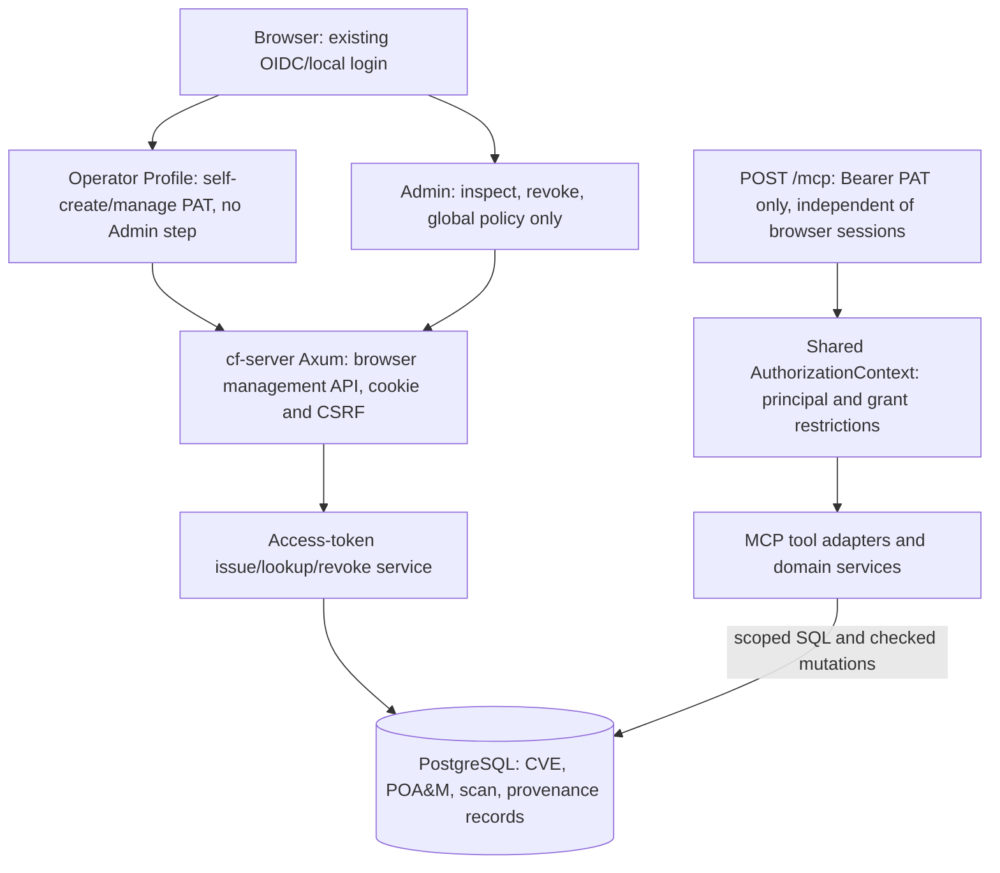
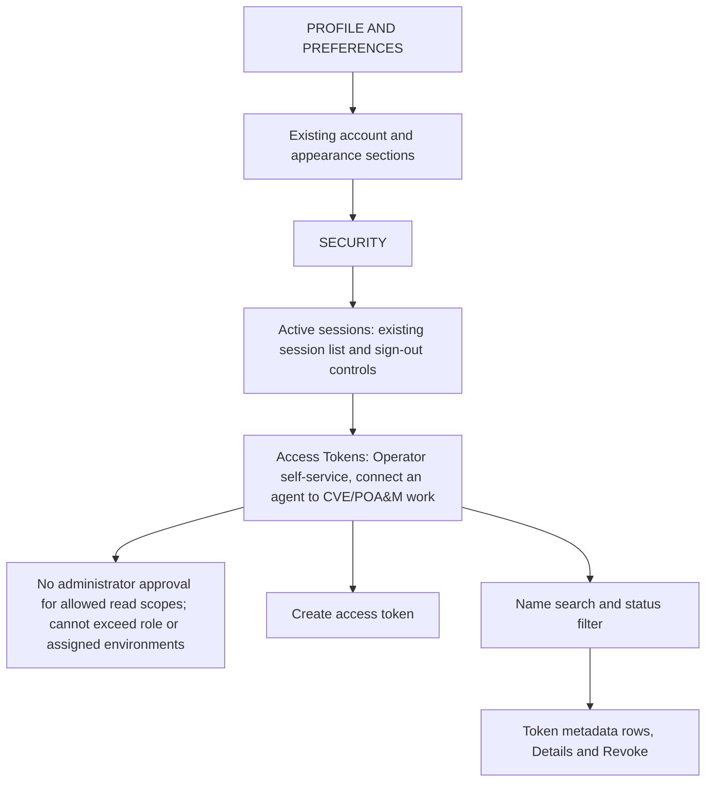

# Crystal Forge: Agent Access Tokens, MCP, and Remediation Context

- Design specification: **CF-AGENT-ACCESS-001**
- Source status at handoff: **Proposed; implementation not started**.
- Version: **1.1 (Operator self-service clarification)**
- Date: **2026-11-16**
- Repository baseline: `dev` at `bd8d068dc287d222baeea9c7336363a03da55371`
- Primary consumers: coding agents over MCP; future Crystal Forge CLI.
- Normative words: MUST, MUST NOT, SHOULD, MAY describe requirements.
- v1.1 change: Explicit Operator-owned CFAT self-service, security-analyst persona, non-admin issue/rotate/revoke workflow, CVE/POA&M Connect agent entry point, and role-matrix acceptance tests. Admin interface remains policy/audit/revocation only.

## Source and implementation tracking

This concept records the user-supplied CF-AGENT-ACCESS-001 v1.1 specification
from the 2026-11-16 implementation request, not implemented API behavior.
The prose and tables below preserve the requirements; source box diagrams are
represented as Mermaid and tab-separated contracts as Markdown tables/lists.
The illustrative SQL remains a schema contract, not an executable migration.
TASK-529 tracks delivery, TASK-529.1 tracks this knowledge/design handoff, and
TASK-529.2 tracks the M0 security prerequisites. M0 authorization and OIDC source
groundwork is implemented for review; PAT issuance and MCP transport remain
unimplemented. No milestone is marked complete by this progress note. See
[credential grant groundwork](credential-grant-groundwork.md) and
[OIDC ownership](oidc-entitlement-ownership.md) for implemented boundaries,
checkpoint-specific farm evidence and remaining release gates.
Our old TASK-526, TASK-526.1 and TASK-526.2 names were session allocation
collisions resolved after rebasing onto origin/dev at `881dbc76`; upstream
TASK-526 remains the farm parser-deadline task. Historical commit hashes and
old branch/worktree paths are retained as provenance.
The user-supplied local HTML export of the linked artifact is a visual reference,
not an authorization authority. Its SHA-256 is
`c1dec2361dd37c4a37bc4736d152442b15904006f69aa9083c3e2abde25585cb`.

## 1. Executive decision

Build a general-purpose Crystal Forge Access Token subsystem in cf-server and expose a read-only-first, environment-scoped MCP server through the existing Axum process. Users authenticate to the Web UI using the server's existing OIDC or local login. They create named, expiring, revocable personal access tokens (PATs) in Profile & Preferences → Access Tokens. Operators, including security analysts, MUST be able to do this without Admin involvement. They manage their own tokens and choose only their assigned environments. Agents send the secret in `Authorization: Bearer <token>` to `/mcp`. The secret is shown only at creation or rotation.

The MCP server MUST reuse Crystal Forge's domain services and security/evidence rules. Access tokens are not browser sessions, OIDC ID tokens, builder keys, or system agent signing keys. The same token service is designed for future cf CLI use, but version 1 issues tokens for the `mcp` audience only. Future CLI tokens MUST use an explicit `cli` audience and separately approved scopes. A token never grants more rights than the owning account.

Ownership decision: Admin is the platform-administration role; Operator is the security-operations role. The token-creation UI and self-service API are not Admin-only. An Admin sets global policy and can audit/revoke tokens, but MUST NOT be required to issue an Operator's token, choose the Operator's per-token environments, or approve every routine Operator token. Scope-specific operational approvals still apply when a protected operation is requested.

Critical prerequisite: existing POA&M authorization refresh methods derive admin and environment access from the user again. MCP token restrictions MUST survive that refresh. Refactor service authorization before exposing mutations.

## 2. Baseline and integration points

Verified in the repository baseline supplied with the specification:

- `packages/default/crates/cf-server/src/bin/server.rs`: Axum routing, CVE, system, POA&M, scan, user-session, and admin APIs.
- `packages/default/crates/cf-server/src/auth/extractors.rs`: RequireAuth, RequireOperator, RequireAdmin, browser-cookie sessions and role lookup.
- `packages/default/crates/cf-server/src/auth/models.rs`: environment-scoped access rules, with a global Admin bypass for human access.
- `packages/default/crates/cf-server/src/handlers/api/auth_oidc.rs`: OIDC role and environment membership assignments on login.
- `packages/default/crates/cf-server/src/handlers/api/auth_local.rs`: local username/password login.
- `packages/default/crates/cf-server/src/handlers/api/user_sessions.rs`: user self-service session management.
- `packages/default/crates/cf-server/src/services/poam.rs`: transaction-aware POA&M authorization, verification, closure, and audit behavior.
- `packages/web-ui/src/views/profile.rs`: current Profile & Preferences screen with Active sessions.
- `packages/web-ui/src/views/admin.rs`: Server Management screen with Users, Roles, OIDC Mappings, Background Jobs, Audit Log, and Server tabs.
- `modules/nixos/crystal-forge/default.nix`: NixOS module; server auth mode defaults to local in this module, while the raw server environment/configuration defaults can differ.
- `backlog/tasks/task-271 - Map-system-CVEs-to-affected-NixOS-modules.md`: unimplemented module-attribution task; this design extends it.

Relevant existing API behavior and source authority are documented in
[fleet CVE triage](../api/fleet-cve-triage-api.md),
[CVE scan operations](../api/cve-scan-operations-api.md), and
[CVE POA&M verification and closure](../poam/cve-poam-verification-and-closure.md).
They remain authoritative for CVE and POA&M lifecycle semantics.

No existing PAT or MCP implementation is assumed. All new endpoints, tables, components, and settings below are proposed.

## 3. Objectives, personas, and exclusions

### 3.1 Goals

1. Let Operators independently create, list, inspect, revoke, and rotate named PATs from their normal Web UI. They MUST NOT require an Admin to create a credential for everyday CVE and POA&M work; the same self-service pattern also supports Viewer read-only tokens and Admin personal tokens.
2. Support both OIDC and local installations without introducing a second login mode or an OAuth authorization server.
3. Limit each token by principal, active account state, concrete environment IDs, capability scopes, audience, and expiry.
4. Guarantee server-enforced isolation of CVE data, systems, POA&Ms, diagnostics, counts, source references, and mutations.
5. Let an MCP client discover remediation work, retrieve authoritative findings and evidence, and find the likely source of NixOS vulnerabilities.
6. Provide bounded, stable, auditable APIs that future CLI commands can reuse without expanding MCP token authority.
7. Support token revocation immediately for requests admitted after the revocation commits.
8. Maintain existing exact-current-evidence, scan freshness, POA&M verification, and closure safeguards.

### 3.2 Personas and role separation

- **Security analyst = Operator:** the primary CFAT user. Logs in through existing OIDC or local auth, opens Profile & Preferences → Access Tokens (or the Connect agent shortcut from CVEs/POA&Ms), creates a personal CFAT without Admin intervention, chooses assigned environment(s) and allowed capabilities, and connects an MCP coding agent. Can list, inspect, rotate, and revoke their own CFATs. Operator status alone never grants visibility outside assigned environments.
- **Viewer:** may self-create read-only CFATs, limited to their assigned environments, unless an explicit global policy disables Viewer token issuance. No write capability is possible with a Viewer principal.
- **Admin:** administers Crystal Forge itself: account roles, environment assignments and OIDC mappings, server/token policy, audit, incident response and global token revocation. Admin can create their own restricted personal tokens, but is not a prerequisite or approval gateway for routine Operator token issuance. Admin cannot retrieve a user's secret or create/rotate a PAT while impersonating that user.
- **Agent:** has no inherent role. It uses a CFAT whose effective permissions come from the current owner plus the immutable token grant.
- **Future service account:** nonhuman first-class principal, independently assigned environments and scopes. This is a later milestone, not a reason to impersonate a human Admin in v1.

| Action | Viewer | Operator (security analyst) | Admin |
| --- | --- | --- | --- |
| Open Profile → Access Tokens | Yes | Yes | Yes |
| Create a CFAT for own account | Read-only scopes | Read and policy-enabled operational scopes | Own account only |
| Select environments on own CFAT | Assigned environments | Assigned environments | Explicit environment IDs, never implicit all |
| View/rotate/revoke own CFATs | Yes | Yes | Yes |
| Use CFAT for scoped CVE/POA&M reads | Yes | Yes | Yes |
| Use CFAT for scans/progress updates | No | When capability is released and globally enabled | When capability is released and globally enabled |
| List/revoke other users' CFATs | No | No | Yes |
| Change roles, OIDC mapping or token policy | No | No | Yes |
| Issue a PAT on another human's behalf | No | No | No |

No new Security Analyst role is required. The existing Operator role identifies analysts and remediation engineers. Admin is for Crystal Forge administration, not regular security remediation. Do not confuse the ability to issue a token with the ability to perform every scoped operation: an Operator can issue a read-only CFAT even when mutation capabilities are disabled.

### 3.3 Primary Operator workflow

1. An administrator assigns the analyst Operator and the applicable environment memberships once, either directly or using existing OIDC group mappings.
2. The analyst signs in with the currently configured OIDC or local flow.
3. The analyst opens Profile & Preferences → Access Tokens or CVEs/POA&Ms → Connect agent. This entry point MUST be visible to an authenticated Operator and MUST NOT use an Admin-route guard.
4. The analyst creates a CFAT with an explicit environment subset, allowed scopes, and expiry; saves the one-time secret to the agent's secret store.
5. The agent calls `/mcp` with the CFAT and sees only those authorized environments and capabilities.
6. The analyst may independently inspect, rotate or revoke their CFAT. An Admin is needed only for existing role/environment assignment, global policy changes, emergency revocation, or operations that already require Admin authority.

Acceptance example: A local or OIDC Operator assigned to staging and production can create a 30-day `cves:read` + `poams:read` CFAT restricted to staging, use it with `/mcp`, and revoke it, without visiting an Admin page or asking an Admin to create/approve the token. Production findings remain invisible to that CFAT.

### 3.3 Non-goals for v1

The duplicated 3.3 numbering is retained from the source specification.

- OAuth authorization-server implementation, OAuth discovery, device authorization, or automatic browser-based MCP client onboarding.
- Automatic remediation commits, GitLab merge requests, shell access, deployment, rollback, risk acceptance, waiver approval, or automatic POA&M closure.
- Reusing browser cookies, OIDC ID tokens, cf-agent host keys, or builder API keys as PATs.
- Promising support for all MCP hosts. v1 supports clients that can supply a static HTTP bearer header.
- Claiming module attribution exists before the provenance pipeline is implemented.

## 4. Architecture and trust boundaries



### 4.1 Authentication channels

- Browser management API: existing `__Host-cf-session` plus CSRF checks for state-changing requests. PAT bearer credentials MUST NOT be accepted for token issuance, privilege changes, or token-grant expansion.
- MCP: `Authorization: Bearer cfat_v1_...` only. Browser cookies MUST NOT authenticate `/mcp`. Token MUST NOT appear in URL query parameters, tool arguments, logs, exception text, or telemetry.
- Future CLI: separate bearer audience. CLI support is not enabled by merely adding CLI-shaped endpoints.
- System agent/builder: existing distinct authentication boundaries remain unchanged.

### 4.2 Authorization formula

For a user-owned PAT and target resource `r` in environment `e`:

```text
allow(operation, r) =
    user.is_active
    AND token.is_active AND token.audience == required_audience
    AND operation.scope IN token.scopes
    AND operation permitted by user's CURRENT Crystal Forge roles
    AND e IN token.explicit_environment_grants
    AND (user.is_admin OR e IN user's CURRENT environment_memberships)
    AND e is active/eligible where domain policy requires it
    AND all existing domain-specific preconditions hold
```

There is no `*`, all environments, omitted-as-all, or implicit Admin wildcard in a PAT. Even an Admin must select concrete environment IDs. Empty environments mean no environment-scoped access. Environment names are display metadata; stable UUIDs are used for enforcement. Invalid or removed environments become inaccessible.

Scopes and environments form an intersection, not a union. The token cannot elevate a Viewer, and a user's later demotion immediately removes write rights. User role/environment changes MUST be re-read from authoritative server state; never trust role or environment claims embedded in a token.

### 4.3 Shared and cross-environment resources

- Systems and single-system findings: expose only if the selected system's current environment is authorized; hidden UUID and nonexistent UUID both return `404 resource_not_found`.
- CVE fleet lists and counts: filter the scoped subject set inside SQL before aggregation, total, cursor, grouping, search facets, export, or pagination. No global counts or hidden host names.
- Flakes, derivations, builds, source paths, and scans: some artifacts are shared across environments. A token may receive only metadata proven to belong to at least one authorized subject; strip unrelated associations and secret-bearing fields. Administrative fleet scan diagnostics are not automatically available through MCP.
- Shared POA&M: read-only tools MAY provide a scoped projection containing only authorized findings and redacted/authorized metadata. The projection MUST NOT disclose hidden subject names, hidden counts, global totals, notes about hidden subjects, or sensitive workflow references. It includes `visibility: "scoped"`; it MUST NOT claim to be the complete POA&M. If a secure projection cannot be produced, fail closed with non-disclosing 404.
- POA&M mutation, verification, or closure: require authorization over every active subject impacted by the operation, not merely one visible finding. Deny a whole-resource operation where the token has only partial coverage. Finding-scoped mutation is a separate, explicitly specified capability; it MUST never silently become whole-resource mutation.
- Environment moves: resolve the current environment at every request/transaction, and deny access when a moved system no longer belongs to the grant. Retained historical evidence does not authorize current mutation.

### 4.4 Mandatory POA&M authorization refactor

The current `services/poam.rs` has `PoamActor { user_id, is_admin, can_mutate, environment_ids, ... }`. Its `current_reading_actor_tx` and `current_mutating_actor_tx` rebuild authority from user role and membership tables. That would discard PAT restrictions, especially for an Admin-owned PAT.

Create a shared immutable grant boundary similar to:

```rust
pub struct AuthorizationContext {
    pub principal: PrincipalIdentity,       // user v1; service principal later
    pub credential: CredentialIdentity,     // browser session or access token ID
    pub audience: Option<AccessAudience>,
    pub granted_scopes: BTreeSet<Capability>,
    pub granted_environment_ids: BTreeSet<Uuid>,
    pub effective_environment_ids: BTreeSet<Uuid>,
    pub effective_actions: BTreeSet<Capability>,
}
```

This is a conceptual shape. Existing human session behavior remains unchanged. Domain services MUST distinguish a privileged human session from a narrowly scoped bearer token. All transaction-level rechecks MUST validate the token row, owner row, current roles/memberships, affected resource membership, and required capability under appropriate locks or equivalent serialization. A refreshed user role MUST NOT widen the original token grant. Revocation and mutations must have deterministic commit-order semantics.

## 5. Token specification

### 5.1 Token format and generation

- Prefix: `cfat_v1_` (Crystal Forge Access Token, format version 1).
- Format: `cfat_v1_<token-id-hex>_<base64url-256-bit-random-secret>`.
- Generate the random secret using a cryptographically secure OS random generator. Never derive a secret from a password, UUID, timestamp, or client input.
- Return plaintext once on creation/rotation. No endpoint can retrieve it again.
- Store SHA-256 of the complete canonical token and a nonsecret public token ID. A 256-bit random secret makes a fast cryptographic hash appropriate; do not reuse password hashing semantics here.
- On lookup, parse a bounded canonical format, index by public ID, verify the full hash with constant-time comparison, and return only the authorization identity and metadata.
- Never put plaintext tokens in the Nix store, database, browser storage, analytics, audit events, crash reports, command-line arguments, or application logs.
- Provide only a masked token hint such as `cfat_v1_8d12…` in later UI reads.

### 5.2 Lifecycle and policy

- Created through an authenticated browser session with CSRF protection; Viewer, Operator, and Admin can create only their own tokens. Operator token issuance MUST NOT call RequireAdmin, the Admin user-management API, or an Admin approval endpoint.
- Required fields: unique-for-owner display name (1–100 characters), `mcp` audience, explicit nonempty environment set, nonempty scopes, and expiry.
- Defaults: 30 days, read-only capabilities selected, no environment selected. Maximum lifetime: 90 days in v1, configurable downward by server policy; never unbounded.
- A Viewer can only select read capabilities. An Operator can create a CFAT immediately with the read scopes enabled by default and may select operational scopes when those features and their server policy are enabled. Admin and Operator can select additional scopes only when the server permits them. An Admin does not need to approve an individual Operator token when its requested scopes already satisfy policy. Production operations still honor existing per-operation approvals.
- Token grants are immutable after issuance. To change environments, capabilities, audience, or lifetime, create a replacement token and revoke the old one.
- Revoke: irreversible; clear the token's ability to authenticate immediately after commit. Retain nonsecret metadata for audit and UI history.
- Rotate: issue a replacement with the same or narrower requested grant and revoke the prior token atomically. Return the replacement secret once. Warn that the old agent connection stops immediately. Users may alternatively create a second token, update the client, and then revoke the old one for a controlled switchover.
- Expiration: enforce against authoritative server time on every operation; do not extend expiry from use or login. Expired tokens cannot be reactivated.
- User disable/deletion: instantly denies the token. Browser logout or browser-session revocation does not automatically revoke PATs; document this distinction. A separate admin 'revoke all tokens for user' action is supported.
- Last used: record coarse, throttled timestamps on successful calls, without making writes the bottleneck for every tool invocation. Never treat `last_used_at` as a security decision input.
- Audit: creation, successful rotation, revocation, failed authorization, and mutating tool calls. Redact request headers and secret-bearing fields.

### 5.3 OIDC entitlement freshness

Current OIDC mapping code synchronizes roles and environments on sign-in. If no matching mapping exists, it may retain earlier assignments; if an environment mapping is absent or invalid, it can retain existing memberships. Therefore querying current Crystal Forge database memberships is not sufficient to know that an IdP group removal has been observed.

Required safeguards before broad OIDC-delegated MCP rollout:

1. Change group-to-role/environment reconciliation to be fail-closed for IdP-managed assignments, while preserving explicitly documented administrator-managed overrides separately.
2. Track the last successful authoritative entitlement sync per OIDC identity.
3. For OIDC-owned PATs, deny requests when entitlement sync exceeds a configurable maximum age (recommended 24 hours) unless a provider-supported reconciliation mechanism has refreshed it. This means an unattended OIDC user token may pause until renewed sign-in or sync; describe that consequence in the UI.
4. Disabling a user or revoking their token in Crystal Forge takes effect immediately, independent of IdP refresh.
5. For long-running unattended work, provide dedicated service principals in a subsequent milestone, with independently administered environment grants, rather than silently exempting a human token from freshness controls.

Local accounts use current local role/membership state without an IdP freshness requirement.

## 6. Database model

The following is a schema contract, not a migration ready to paste into production. Migration numbering, indexes, SQLx integration, and compatibility must be aligned to current dev.

```sql
CREATE TABLE api_access_tokens (
    id UUID PRIMARY KEY DEFAULT gen_random_uuid(),
    user_id UUID NOT NULL REFERENCES users(id) ON DELETE CASCADE,
    name TEXT NOT NULL CHECK (char_length(name) BETWEEN 1 AND 100),
    audience TEXT NOT NULL CHECK (audience = 'mcp'),
    secret_hash BYTEA NOT NULL UNIQUE CHECK (octet_length(secret_hash) = 32),
    display_hint TEXT NOT NULL,
    created_at TIMESTAMPTZ NOT NULL DEFAULT now(),
    expires_at TIMESTAMPTZ NOT NULL,
    revoked_at TIMESTAMPTZ,
    revoked_by_user_id UUID REFERENCES users(id),
    last_used_at TIMESTAMPTZ,
    CHECK (expires_at > created_at)
);

CREATE TABLE api_access_token_scopes (
    token_id UUID NOT NULL REFERENCES api_access_tokens(id) ON DELETE CASCADE,
    scope TEXT NOT NULL,
    PRIMARY KEY (token_id, scope)
);

CREATE TABLE api_access_token_environments (
    token_id UUID NOT NULL REFERENCES api_access_tokens(id) ON DELETE CASCADE,
    environment_id UUID NOT NULL REFERENCES environments(id) ON DELETE CASCADE,
    PRIMARY KEY (token_id, environment_id)
);

CREATE INDEX api_access_tokens_user_idx
    ON api_access_tokens(user_id, created_at DESC);
CREATE INDEX api_access_tokens_expiry_idx
    ON api_access_tokens(expires_at) WHERE revoked_at IS NULL;
CREATE INDEX api_access_token_env_idx
    ON api_access_token_environments(environment_id, token_id);
```

Additional migration requirements: enforce a unique name per owner if chosen; validate scope allowlists at both API and database boundary; bound token and environment counts; avoid exposing hashed secrets through admin queries; add appropriate audit event schema; retain revocation history under the existing audit retention policy. If user deletion must preserve audit accountability, use an audit-safe pseudonymous actor reference before deleting their token rows. Future service principals need an explicit principal schema change; they MUST NOT be simulated with an unrestricted Admin user.

## 7. Capability taxonomy and authorization

| Scope | Operation | Minimum human role | Release gate |
| --- | --- | --- | --- |
| `cves:read` | List and inspect scoped CVEs and system evidence | Viewer | v1 |
| `poams:read` | Read scoped remediation plans and relationships | Viewer | v1 |
| `provenance:read` | Read authorized Nix derivation, flake, and module provenance | Viewer | v1 (known fields only); expand later |
| `scans:request` | Request a new eligible scoped scan | Operator | phase 2, explicit policy |
| `poams:write` | Edit permitted progress fields; no risk/closure | Operator | phase 3, explicit policy |
| `poams:verify` | Invoke server-authoritative verification | Operator | phase 3, explicit policy |
| `poams:close` | Close only after all required evidence and approvals | Operator | out of v1; separate explicit policy |

CFAT issuance is a self-service credential operation, separate from the domain scope gate. A security analyst with Operator role does not need Admin permission to create `cves:read` or `poams:read` tokens; when released and permitted by policy, that Operator can also select `scans:request`, `poams:write`, or `poams:verify`. The MCP tool and the existing domain service must still authorize each operation. Admin privileges never appear as a token scope.

Do not introduce a broad `admin`, `*`, `execute`, `sql`, `shell`, `deploy`, or `accept_risk` token scope. Every tool has an exact scope mapping. Read endpoints that return sensitive provenance require `provenance:read`, not just `cves:read`.

A future CLI defines its own endpoint and audience-to-scope matrix. The existence of a `poams:write` scope does not imply that the CLI may use it.

## 8. Browser REST API contract

All proposed endpoints are under `/api/v1`. All self-service POST/DELETE methods use browser session + CSRF, not PATs. The entire `/user/access-tokens` API is accessible to an authenticated Operator, independent of the Admin console; no Admin role, Admin-created token, or per-token Admin approval is required. The Owner check applies to list/detail/rotation/revocation.

| Method | Endpoint | Purpose | Access |
| --- | --- | --- | --- |
| GET | `/user/access-token-policy` | Effective allowed environments, selectable scopes, expiry policy, MCP status | Viewer/Operator/Admin (own role + scope) |
| GET | `/user/access-tokens` | Own token metadata, paged | Viewer/Operator/Admin (owner only) |
| POST | `/user/access-tokens` | Self-create own token; plaintext returned once | Viewer/Operator/Admin + CSRF; NOT Admin-only |
| GET | `/user/access-tokens/:id` | Own token metadata; never secret | Owner |
| DELETE | `/user/access-tokens/:id` | Revoke own token | Owner + CSRF |
| POST | `/user/access-tokens/:id/rotate` | Atomic replacement; plaintext returned once | Owner + CSRF |
| GET | `/admin/access-tokens` | Paginated token metadata across accounts | Admin |
| DELETE | `/admin/access-tokens/:id` | Revoke any token | Admin + CSRF |
| POST | `/admin/users/:id/access-tokens/revoke-all` | Revoke all of user's tokens | Admin + CSRF |
| GET | `/admin/mcp/status` | Read declarative MCP/runtime policy, status, and endpoint URL | Admin |

POST `/user/access-tokens` request:

```json
{
  "name": "OpenCode on Sledge",
  "audience": "mcp",
  "expires_in_days": 30,
  "environment_ids": ["00000000-0000-0000-0000-000000000001"],
  "scopes": ["cves:read", "poams:read", "provenance:read"]
}
```

Success `201 Created` returns metadata plus `token` exactly once. For a regular list or detail response, the `token` field is absent, not empty or masked as a real secret. The server rejects repeated, unknown, inactive, or unauthorized environment IDs; unknown or disallowed scopes; invalid dates; excessive grant counts; and unsupported audiences. Token creation MUST not silently reduce requested access: it either creates the exact authorized grant or rejects it with actionable validation errors.

Response rules: 400 malformed/invalid, 401 unauthenticated, 403 role/capability denied, 404 hidden or absent resource, 409 revision or lifecycle conflict, 429 rate limit, and 503 security-critical backing service unavailable. Responses have machine-readable code, safe message, and a request ID. Browser endpoints MUST apply user-level rate limits and never cache one-time secret responses.

## 9. MCP interface and tool contracts

### 9.1 Transport and compatibility

- Embed an MCP router in cf-server; default endpoint `https://<external-host>/mcp` when enabled.
- Use Streamable HTTP with JSON-RPC; implement and test an explicitly selected protocol version with documented client compatibility (target established 2025-11-25 interoperability first, rather than assuming every client supports the later 2026-07-28 era).
- Require a PAT bearer header on every MCP request; no anonymous `tools/list`, HTTP cookie fallback, or URL token parameters.
- Implement correct transport method, content type, protocol negotiation, and session behavior for the chosen version. Prefer stateless execution where the chosen protocol supports it. Session identifiers MUST NOT serve as authentication credentials.
- Enforce Origin/host validation, HTTPS through trusted reverse proxy, request size and time budgets, cancellation handling, and client concurrency limits.
- PATs are static bearer credentials, not OAuth access tokens issued through the MCP OAuth authorization flow. v1 MUST be advertised as a manually configured bearer-token integration, not full MCP OAuth authorization compliance. Some hosted clients will not support it.
- Disable generic MCP sampling actions, arbitrary URL fetchers, shell execution, direct SQL, and unrestricted file reads.

### 9.2 Tool discovery and response design

- `tools/list` returns only tools enabled for the PAT's current effective capability set. A tool call MUST independently reauthorize even if the client cached an earlier tool list.
- Tool descriptions and JSON schemas MUST be stable, precise, and not contain hidden data or other users' resources.
- All collections use bounded limit and opaque, scoped cursors. Choose safe defaults (25) and maximum 100 unless the existing domain endpoint defines a stricter bound.
- Return `evidence_authority`, timestamps, provenance completeness, current vs historical state, and source identifiers where relevant. Unknown data is unknown or null, never guessed.
- Avoid giant dumps. Provide summary first and separate targeted evidence queries.
- Tool results and CVE descriptions are untrusted input to an LLM. Tool output MUST not contain secrets or hidden HTML/script payloads.

### 9.3 Phase 1 tools (read-only)

#### list_remediation_work

Scope: `cves:read` and `poams:read` when POA&M fields are requested.

Inputs: optional `environment_ids` (explicit subset of token scope; omitted = all token-granted environments), `status`, `severity`, `assigned_to_me`, `limit`, `cursor`, `include_poams`. Outputs: authorized work items with system ID, environment ID, CVE/package key, severity, current evidence status, POA&M reference where visible, and cursor. No hidden environment names or global counts. An invalid environment selector is an error, never a request to scan globally.

#### get_system_security_context

Scope: `cves:read`.

Inputs: `system_id`, optional `view` (current default; historical only if supported safely), bounded page/cursor. Outputs: management mode, current environment, observed generation and running derivation, CVE scan status, exact-authority classification, scan completion time, vulnerabilities, and visible remediation relationships. `no_scan` is not equivalent to 'clean'. Managed deployment evidence and external/reference configuration evidence are distinguished.

#### get_remediation_context

Scopes: `cves:read` + `provenance:read`.

Inputs: `system_id`, canonical `cve_id`, canonical `package_name`, optional exact finding/scan ID for navigation. Outputs: exact evidence key, affected package version and store path when known, configuration/flake reference and pinned revision when authorized, available dependency/derivation chain, source/module attribution candidates, remediation suggestions as non-authoritative hints, scan/authority timestamp, and confidence/unknown flags. No invented module mapping. A CVE/package-only request without a system is disallowed because individual remediation authority is system-scoped.

#### get_poam_detail

Scope: `poams:read`.

Inputs: `poam_id`, bounded related-subject page/cursor. Outputs: either a fully authorized POA&M or an explicit safe scoped projection with `visibility: "scoped"`. Return lifecycle state, revision, visible milestones/findings, authorized evidence, and visible notes only. If a safe projection cannot be produced, return non-disclosing not found.

### 9.4 Later explicitly gated tools

- `request_cve_scan` (`scans:request`): `system_id`, `expected_derivation_id`, idempotency key; invokes the existing scoped scan-admission service. Return queued/accepted scan ID, not a remediation PASS.
- `get_scan_result` (`cves:read`): read bounded status and authorized summary of a scan attached to an in-scope system; a queue ID alone grants no access.
- `update_poam_progress` (`poams:write`): narrow allowlist of notes, permitted milestone fields, and statuses; require current revision and explicit target scope. No changing risk acceptance or silently replacing evidence.
- `verify_poam` (`poams:verify`): only all-subject-authorized POA&Ms, exact evidence checks, current revision, audit.
- `close_poam` (`poams:close`): separately gated, all-subject-authorized, existing lifecycle and verification preconditions; disabled by default and excluded from v1.

No tool may trigger nix evaluation or arbitrary commands on the server just to explain a CVE. All costly provenance work is queued or derived from known, authorized persisted evaluation/scan data under bounded operations.

### 9.5 Tool error contract

Use stable codes such as `unauthenticated`, `token_expired`, `token_revoked`, `scope_denied`, `resource_not_found`, `environment_not_authorized`, `partial_resource_scope`, `evidence_not_authoritative`, `scan_executor_unavailable`, `scan_target_changed`, `revision_conflict`, and `rate_limited`. A hidden resource should not be distinguishable from an absent one; the internal audit can retain the exact reason. Do not expose SQL errors, underlying IDs for hidden environments, or system-internal filesystem paths unless explicitly authorized provenance.

## 10. UI information architecture and visual requirements

Use the existing Dioxus design system from `packages/web-ui/src/views/profile.rs` and `views/admin.rs`; preserve page-head, page-title, page-subtitle, card, sd-tabs, chip/badge semantics, spacing, responsive layout, modal patterns, error patterns, and keyboard behavior. Do not redesign the entire account or admin UI.

### 10.1 Profile & Preferences → Access Tokens (Operator-first, all signed-in users)

This is the primary creation and management UI for security analysts with Operator role. Add an Access Tokens card to the existing Profile & Preferences security/account area, adjacent to Active sessions, rather than introducing a new top-level page in v1. Keep the existing Active sessions functionality intact. The Profile page and the token section MUST be accessible to Operators in both OIDC and local authentication modes. They MUST NOT be nested under the Admin route, protected by an Admin-only component guard, or hidden because the user lacks Admin.

The Operator can create a CFAT, copy it, review permissions, rotate it, and revoke it directly. Admin operations in section 10.5 are an additional oversight interface and not part of this normal workflow.

Desktop section layout:



Requirements:

- Operator access: Show the Create access token button on the Operator's normal Profile page (as well as on Viewer/Admin profiles). Never check `is_admin` to render or call the self-service creation endpoint.
- Columns: Name, audience/type, environment summary, scope summary, creation date, last used, expiry, status, and actions. Show only own tokens.
- Status: Active, Expiring soon (within 7 days), Expired, Revoked, or owner access suspended. Clear statuses use text plus icon, not color alone.
- Search by name; filters Active/Expired/Revoked and audience. Default sort newest first. Server-side pagination.
- Each row has View details, Rotate, and Revoke for active tokens. Inactive rows have Details only.
- Show a concise security note: tokens survive browser sign-out, but not revocation, account disable, owner permission removal, or expiry.
- No plaintext token or secret hash in any list/detail response.

#### 10.1.1 CVE and POA&M quick entry for Operators

Add a Connect agent action to the existing authenticated Fleet CVEs and POA&M work views for Operators. This is a discoverable shortcut to the same Profile access-token workflow, not a second issuance system. Keep existing CVE/POA&M sections and controls intact. On click, open the Profile token-creation flow with a non-authoritative context hint such as the currently selected environment. The server MUST resolve permitted environment IDs and scopes again; the UI MUST NOT auto-issue a token or place a token in a URL.

If an Operator already has an active CFAT, the shortcut MAY offer Manage access tokens instead. The quick entry MUST NOT expose Admin-only token metadata or permissions. If MCP is disabled, show a clear explanation and a link to the existing Profile token list; do not show a misleading Create action that will always fail. A Viewer may receive a read-only shortcut if consistent with product design, but Operator access is mandatory.

### 10.2 Create Access Token modal

Use a responsive modal on desktop and a full-width, scrollable dialog/sheet on mobile. Recommended content order:

1. **Create Access Token**, close control, and explanation: Create your own credential for an agent. Operator access does not require Admin approval. The secret is shown once.
2. **Details:** required token name (example `OpenCode - Sledge`); required Use with (`MCP Server`, v1 only); required expiration (7, 30 selected by default, or 90 days).
3. **Environments:** Select at least one of your authorized environments; Development, Staging, Production checkboxes and environment search; no 'All environments' wildcard.
4. **Capabilities:** selected Read CVEs and systems, Read POA&Ms, Read authorized provenance; Request CVE scans and Update POA&M progress disabled until allowed by policy.
5. **Review:** Effective access summary (example 1 environment · 3 read scopes · 30 days); Cannot exceed your current permissions; Production/write scope warning when applicable.
6. **Cancel** and **Create token** actions.

Behavior and validation:

- For an Operator, show only currently assigned active environments; selecting a subset is permitted, but no implicit all-environments selection. A concrete default is none selected. Admin may choose active environments but still must select explicit IDs.
- Operators can submit the modal directly. Do not add an Admin approval, Admin role check, or requirement for an administrator to create the CFAT on their behalf.
- If no environments are available, show an explanatory empty state and disable creation.
- Display why a scope is unavailable (Requires Operator, Disabled by server policy, or Not supported yet). Do not display an unavailable scope as apparently selectable.
- The form validates name length, nonempty environment list, nonempty scopes, and server maximum lifetime. Server repeats every validation.
- For Production write scopes in a future phase, require explicit confirmation that identifies the environment and operation category. This confirmation does not replace server authorization or approval workflow.
- On API failure, preserve the form and show a field-level or top-level actionable error; never assume creation succeeded.
- On success, replace the form with the one-time secret reveal view. Do not keep the secret in browser storage, URL, app-global state, telemetry, or server-rendered logs.

### 10.3 One-time token reveal

The Access Token Created view shows success and the token name (`OpenCode - Sledge`), the warning “This is the only time the secret will be displayed,” a masked `cfat_v1_` token with Copy, the MCP endpoint (`https://forge.example.com/mcp`) with Copy, `Header: Authorization: Bearer <token>`, a required “I have saved the token in my agent's secret store” acknowledgement, and Done.

- Copy button provides accessible confirmation; do not automatically copy to clipboard.
- The token text may be shown/unmasked on explicit user action, with a warning about shoulder surfing. Never echo it in a tooltip or analytics event.
- Show a generic MCP client example using an environment-variable-backed Authorization header, not a fabricated OpenCode config format.
- Do not permit UI navigation back to retrieve the secret later. A second reveal requires new issuance, not retrieval.
- Prevent HTTP caching with `Cache-Control: no-store` on the creation response.

### 10.4 Token details, revoke, and rotate

Details drawer: name, masked hint, owner (self), audience, grants, current effective access (with unavailable environments clearly marked), created, last used, expires, status, and audit summary. Distinguish granted from currently effective permissions. Actions: Rotate, Revoke.

Revoke dialog: Revoke “OpenCode - Sledge”? This immediately blocks new requests. A running tool call may already be in progress. Destructive, non-default action. After success, row status becomes Revoked; failed requests show no false success.

Rotate dialog: state that old token is revoked atomically and connectivity may stop until the client is updated. After confirmation, show the new one-time secret, new public ID, and replacement expiry. If the user wants a zero-downtime switch, instruct them to create a second token and revoke the first after client update.

### 10.5 Admin / Server Management / Access Tokens (oversight only)

Do not use this screen to create an Operator's CFAT. Admin controls global Crystal Forge security settings and responds to security incidents; security analysts own their operational tokens from Profile. Add Access Tokens to the existing Admin sd-tabs. Preserve tabs in their present order; place Access Tokens after Users/Roles or after OIDC Mappings, before Audit Log. Use the existing role-protected admin route; do not add this to the ordinary user navigation.

Server Management tabs retain Users, Roles, OIDC Mappings, Jobs, Audit, Server, with Access Tokens inserted after OIDC Mappings. The token tab includes Active, Expiring soon, and Revoked totals (illustrative 42/4/13), Search name/owner, User, Environment, Status and Type filters, and rows with Owner, Token, Type, Env count, Last used, Expires, Status, Inspect and Revoke.

Admin requirements:

- Admin can list metadata, inspect grants, inspect recent usage/audit, revoke one token, and revoke all for a selected user. Admin cannot reveal any token secret. An Admin cannot edit or enlarge an Operator's existing token grant; the owner issues a replacement if needed.
- Admin MUST NOT create a token impersonating another human user. An admin-managed service principal is a later separate workflow.
- Filters and counts are backed by paged admin-authorized queries, not client-side summaries of all token records.
- Clicking a user from the existing Users tab MAY include a link to that user's token metadata; it must not expose credentials.
- Token revocation and token-audit actions appear in existing Audit Log with the actor, token public ID, and affected user.

### 10.6 Admin / Server tab / MCP Server status card

Add a card in the existing Server tab with:

- Enabled/Disabled status (read from declarative server config).
- External MCP URL and Copy button; show 'URL not configured' if unavailable, never infer an incorrect public scheme/host from an arbitrary request header.
- Authentication: Crystal Forge Access Token; user login source: current configured OIDC or local.
- Protocol version, transport, supported feature phase, read-only/write policy, max token lifetime, active token count, and relevant security health warnings.
- Open Access Tokens link to the new admin tab.
- Explicit text: Server enablement and external URL are managed in NixOS configuration. Read-only UI display, no misleading operational toggle that cannot persist.
- An emergency 'Suspend MCP requests' control is permitted only if backed by an actual database-configured runtime kill switch, audited and immediately enforced. Do not render a decorative control.

### 10.7 Admin Access Inspector (authorization explainability)

Add an Inspect effective access action to each Admin token details drawer. The form accepts a target environment and, optionally, a system or POA&M ID and a capability. The server evaluates the same authorization code used by MCP, without performing the requested operation.

The result shows Allowed or Denied, the token's audience and status, its selected environments and capabilities, the owner's current role and membership checks, and any missing scope or lifecycle prerequisite. It must not disclose metadata for hidden targets in ordinary-user views. Admin inspection is audited and is not a way to execute a tool. No permission calculation may be performed solely in the browser. A test must compare the inspector result with a real MCP request under the same database state.

### 10.8 CVE, System Detail, and POA&M UI changes

The agent integration needs useful security context in the existing human workflow, not only in MCP. Operator security analysts are the primary users of these screens and can access the Connect agent shortcut defined in section 10.1.1 without Admin rights:

- **Fleet CVEs (`views/cves.rs`):** preserve the current exact CVE/package selection and Current, Scheduled Configuration, and Historical sections. In the existing CVE detail/triage drawer, add a Remediation context section after evidence details, not in place of severity, occurrences, disposition, or POA&M relationships. Show affected authorized systems, package/store-path evidence, candidate remediation path, source revision, and attribution confidence. A link opens the authorized System Detail CVE view. Do not display a misleading "fixed" badge when the only evidence is a planned change.
- **System Detail → CVEs (`views/system_detail.rs` and `components/cve`):** add a Source and ownership subsection for a selected exact CVE/package occurrence. Show current authority (exact, mapped-running read-only, historical, or no scan), scanned derivation and date, source flake revision, nixpkgs input, dependency chain and candidate module locations when known. Each field displays Verified, Inferred, or Unavailable status. Add a bounded link to related POA&M and an optional Copy remediation reference action that copies nonsecret IDs and source context, not PATs.
- **POA&M register and detail (`views/poams.rs`, `components/poam`):** preserve the current register, lifecycle actions, notes, milestones, linked findings, audit, and verification sections. In the detail view, add an Agent remediation context panel with exact authorized CVE/package subjects, recorded evidence authority, expected fresh-scan requirement, relevant source references, and whether the resource can be operated on within one scope. Distinguish a partial visibility projection from complete POA&M authority. Provide only navigation/copy context in v1, not an automatic "Resolve" or "Close" button.
- **Cross-screen navigation:** use existing route/query conventions. Deep links must repeat server authorization and must not include a token in the URL. If context is unavailable or outdated, display a clear reason and a link to the relevant scan/workflow, rather than an empty success state.

For each affected drawer/page, the implementation review MUST explicitly compare against the existing design example and record missing sections, reordered sections, merged concepts, omitted metadata, changed behavior, and altered visual hierarchy. Current authorization and scan-specific warning states must remain visible after adding the remediation sections.

### 10.9 Loading, empty, error, and mobile states

Every new section and modal MUST implement skeleton/loading, empty, error, permission-denied, expired-session, disabled-MCP, validation-error, mutation-pending, and success feedback. Revoke/rotate buttons disable during submission to prevent duplicates. A token creation request that has succeeded but whose one-time response was lost MUST NOT be replayed to expose another secret; tell the user to create a replacement and revoke the unknown token.

On narrow screens, render token records as cards with labels; do not force horizontal scrolling of secret or action controls. Use appropriate heading levels and accessible names. Focus is trapped in modals, restored to the trigger on close, and announcements use aria-live where appropriate. Follow the existing design system for colors, high-contrast text, focus rings, and reduced-motion behavior. Do not replace adjacent profile or admin sections, reorder them unexpectedly, or merge distinct concepts (granted vs effective permissions, sessions vs PATs, read vs write scopes).

## 11. NixOS and runtime configuration

Extend the existing `services.crystal-forge.server` module with declarative options. Illustrative option names, to be reconciled with cf-config:

```nix
services.crystal-forge.server = {
  auth_mode = "oidc"; # or "local"; existing setting
  accessTokens = {
    enable = true;
    defaultLifetimeDays = 30;
    maxLifetimeDays = 90;
  };
  mcp = {
    enable = true;                # default false
    publicUrl = "https://forge.example.com/mcp";
    allowMutationTools = false;  # default false
    # Authentication inherits server.auth_mode; no second IdP.
  };
};
```

All listed new options are proposed, not current module options. Set safe defaults: MCP disabled until explicitly enabled; no write scopes in the initial release; bound requests, cursor page size, and concurrency; require a valid HTTPS external URL for public deployment (loopback may use HTTP in development). Validate contradictory options at startup and fail safely. Generated config must not contain PAT secrets. Respect trusted-proxy configuration; validate Host and Origin for MCP as applicable. Expose a clearly defined readiness indicator without disclosing secret configuration.

## 12. CVE remediation evidence and provenance

A useful remediation agent needs more than CVE names. Its core question is: Which change in the pinned NixOS source will remove this exact vulnerable package from the currently affected system?

Target response chain:

```mermaid
flowchart LR
  Env[Environment] --> System[System]
  System --> Running[Authoritative running derivation]
  Running --> Scan[Newest completed eligible scan]
  Scan --> Finding[CVE and canonical package]
  Finding --> Store[Vulnerable store path and dependency edge]
  Store --> Source[Pinned flake revision and nixpkgs input]
  Source --> Modules[Evaluated NixOS options, module paths, overlays or overrides]
  Modules --> Change[Source location, candidate change, required build and scan checks]
```



The server MUST distinguish:

- `exact`: supported by server-authoritative runtime/scan/source evidence.
- `inferred`: plausible dependency/module candidate, not a verified cause.
- `unknown`: evidence unavailable or no stable mapping.

Never treat a legacy scan, historical package, queued scan, missing scan, planned deployment, or evaluation as proof that a currently running vulnerability is fixed. A successful build or scan of a new derivation is not proof of deployment. Existing POA&M verification remains authoritative and requires exact current evidence and freshness as already documented.

Implement TASK-271 as reusable provenance data consumed by both the MCP tool and CVE/System Detail Web UI. Resolve pinned source revision and package/derivation edges first; add module-path attribution only when the derivation/evaluation pipeline supplies defensible evidence. Use Nix tools such as `nix why-depends` in bounded, server-controlled jobs, not arbitrary MCP-provided shell commands. Never return SSH keys, flake credentials, netrc contents, or unrelated sensitive source material.

## 13. Remediation workflow

1. **Discover:** agent calls `list_remediation_work` for only its granted environments.
2. **Understand:** agent calls `get_system_security_context` and `get_remediation_context` for a specific exact CVE/package/system occurrence.
3. **Plan:** agent classifies pin update, override, overlay, option/module change, upstream fix availability, and confidence. If provenance is unknown, request more evidence; never invent a guaranteed fix.
4. **Change source:** agent edits a checked-out repository using its own approved coding tools. Crystal Forge MCP does not grant repository write or arbitrary command execution.
5. **Validate:** local or CI Nix evaluation/build/test, followed by applicable Crystal Forge scan and deployment workflow. An accepted scan request is not a completed scan.
6. **Verify:** server reconciles latest observed running state, exact scan authority, and POA&M verification evidence; partial or stale results do not pass.
7. **Close:** only when a later, separately approved capability is enabled and every subject and lifecycle precondition passes. Otherwise the agent proposes closure for a human.

Output should allow an agent to cite system ID, CVE/package key, current scan ID, source revision, evidence authority, confidence, and the exact state that still requires remediation.

## 14. Security and threat model

Threats: leaked bearer token, prompt injection from vulnerability text, malicious or compromised MCP client, user membership change, OIDC group removal not yet synchronized, token grant escalation, cross-environment inference from shared resources and totals, replay, cursor abuse, denial of service through bulk queries/scans, confused deputy through privileged domain services, and secrets accidentally included in response/logs.

Controls:

- Least privilege by current principal + immutable grant + audience + exact scope + per-resource environment checks.
- One-time high-entropy credentials; hash at rest; mandatory expiry; revocation; no query-string secrets; HTTPS; short bounded responses.
- Recheck identity, token, and resource scope for each operation. Mutations serialize against revocation and membership changes; no blanket Admin bypass for a PAT.
- All search and aggregation scope pushed into SQL; non-disclosing not-found behavior for hidden IDs.
- Per-token and per-IP limits; bounded pagination and scan admission; no arbitrary SQL, shell, filesystem, or URL-fetch tools.
- Treat external CVE feeds, package names, notes, and tool results as untrusted content. Prompts/instructions found in that content never override authorization or trigger actions.
- Mutations require explicit capability, current revision/idempotency controls where applicable, domain service validation, and audit.
- PAT-management endpoints remain session+CSRF only. Host/Origin checks apply at the MCP transport. Do not mistake a Bearer header for CSRF protection on cookie endpoints.
- Remove secrets from logs and traces. Tests MUST inspect HTTP responses, Web UI storage behavior, and structured logs for token leakage.
- Distinguish revocation of future requests from cancellation of already queued scans/jobs; offer separate cancellation where supported.

## 15. Testing and acceptance criteria

### 15.1 Authentication and lifecycle (P0)

- Local and OIDC human logins create a PAT through the same UI; no new login flow. An Operator in either mode can issue, list, rotate and revoke their own token without Admin approval or access to any `/admin` endpoint.
- Only an authenticated browser session with valid CSRF can create, rotate, or revoke PATs.
- Secret is visible only once and only its SHA-256 hash is stored; admin never sees plaintext.
- Invalid, expired, revoked, malformed, wrong-audience, disabled-user, or unknown tokens are denied before any tool result.
- Name, expiry, audience, scopes, and environment sets are validated and bounded; unknown scopes are rejected.
- Owner role downgrade or environment membership removal blocks the affected action on the next admitted request.
- An Operator restricted to staging can issue a staging-only read CFAT, call MCP, see only staging CVEs/POA&Ms, rotate and revoke it, all while having no Admin role.
- An Operator cannot issue a token for an unassigned environment, access another user's token metadata, modify server token policy, or create a PAT on another user's behalf.
- When `scans:request` is enabled globally, a permitted Operator can select it without per-token Admin approval. The target system and scan operation remain subject to scoped authorization and admission checks.
- OIDC entitlement freshness policy is implemented, tested, and presented honestly in UI.
- Admin-owned PAT limited to one environment does not gain other environments at a service-level role refresh.
- Revocation racing a mutating tool has deterministic transaction ordering; post-revocation admission cannot succeed.

### 15.2 Environment isolation and domain correctness (P0)

- User/token combinations across Viewer, Operator, Admin, single/multiple/no environments, inactive environments, and moved systems have no scope escalation.
- A guessed hidden system/POA&M/scan UUID does not reveal its existence.
- CVE search totals, facets, pagination cursors, and exports never include hidden environments.
- Shared derivation and flake evidence includes only authorized associations and redacted source metadata.
- Shared multi-environment POA&M read is safely projected or denied; whole-resource mutations are denied without all-subject authorization.
- Admin Access Inspector decisions match actual MCP authorization for the same state and cannot be used to bypass permission checks.
- `no_scan`, legacy, historical, queued, and non-authoritative scans never appear as current clean or verified remediation.
- POA&M verify/close services retain current exact-authority, revision, lifecycle, freshness, and all-subject gates.

### 15.3 MCP protocol and client compatibility (P1)

- Supported protocol version(s) and static-header compatibility are documented; independent MCP client integration test passes over Streamable HTTP.
- `tools/list` is capability-filtered; cached tool invocation is independently rechecked.
- Invalid Origin, host, oversized JSON, invalid content type, bad transport version, rate limit, and unauthorized tool call fail predictably.
- No sampling, unrestricted file, URL-fetch, command, or SQL escape hatch is exposed.
- Long-running and concurrent requests obey time/concurrency budgets. Scan acceptance is not reported as completion.

### 15.4 UI and visual parity (P1)

- Profile preserves every existing section and Active sessions behavior; Access Tokens is added without reordering/merging unrelated sections. Operator screenshots/tests show a visible Create button and successful issuance without Admin navigation or API calls.
- The Operator's Fleet CVEs/POA&Ms include a working Connect agent shortcut into their own Profile token creation; it does not create a token or bypass server authorization automatically.
- Admin preserves Users, Roles, OIDC Mappings, Background Jobs, Audit Log, and Server; adds token metadata management and MCP status only.
- Test every modal/drawer for desktop, tablet, and mobile layout against existing component conventions.
- Fleet CVE, System Detail CVE, and POA&M detail preserve all existing sections, metadata and interactions; remediation context is additive and clearly marked by evidence confidence.
- Token list, create, one-time reveal, details, rotate, revoke, admin list, admin revoke, and MCP status have appropriate loading, success, error, empty, expired, denied, and disabled states.
- All interactive controls work with keyboard, screen reader names, focus management, sufficient contrast, and reduced-motion settings.
- Secret display cannot leak through browser persistence, URL, console, hydration data, or error logs.

### 15.5 Performance and regression (P1/P2)

- Index lookup by token public ID and hash does not require a table scan.
- Authorization and inventory queries remain bounded with no per-row user/environment queries or full unfiltered fleet materialization.
- `last_used_at` updates are throttled; concurrent agent calls do not lock one hot token row for every read.
- Integration tests use real SQLx/PostgreSQL migrations and Axum HTTP paths. Include real OIDC-group-mapping fixture coverage and role/environment mutation races.
- UI and NixOS module checks run; CLI does not accidentally gain access; existing browser session, builder, and cf-agent authentication regressions pass.

Release gate: no P0/P1 security/authorization findings unresolved, no missing UI states, no unverified current-authority behavior. If a test has not run, mark it unverified rather than claiming success.

## 16. Milestones and dependencies

### M0. Authorization groundwork (merge blocker)

- General AuthorizationContext with immutable grant restrictions and safe domain-service rechecks.
- Reconcile OIDC mappings without retaining revoked IdP-managed memberships; implement entitlement freshness.
- Cross-environment authorization tests, including Admin-owned restricted credentials and multi-environment POA&Ms.

### M1. Reusable PAT service and UI

- SQL migration, token generation/hash/validation, create/list/inspect/revoke/rotate, audit, rate limits.
- Operator self-service first: Profile token section, creation and one-time reveal, details, status, rotation and revocation, tested under both local and OIDC Operator identities, plus a CVEs/POA&Ms Connect agent shortcut. The Admin token tab is oversight only.
- Token audience model that prevents CLI or REST reuse without explicit future policy.

### M2. Read-only MCP server

- NixOS module switch and runtime status card; Streamable HTTP with documented interoperability.
- Four read tools: `list_remediation_work`, `get_system_security_context`, `get_remediation_context`, `get_poam_detail`.
- Comprehensive read isolation and performance tests; initial remediation context reports unknown source attribution honestly.

### M3. NixOS provenance / TASK-271

- Bounded package-to-store-path-to-derivation-to-module/source attribution pipeline.
- Shared remediation context for MCP, REST, CVE list/drawer, and System Detail UI.
- Confidence/provenance tests for direct/transitive/ambiguous/missing attribution and pinned revisions.

### M4. Controlled remediation operations

- Explicit `scans:request` and `poams:write` policies, scan result, progress updates, revisions, idempotency, and audit.
- No general deployment, closure, or risk-acceptance tools.

### M5. Future CLI and service principals

- Dedicated cf CLI audience and scopes; independent audience enforcement tests.
- Admin-managed service principals and independent environment/capability grants for long-running automation.
- Evaluate OAuth later only when named clients require it. Do not silently broaden existing PATs.

## 17. Implementation map and documentation deliverables

Expected areas of change (exact names are implementation choices):

| Area | Proposed work |
| --- | --- |
| cf-server/migrations | PAT, grant junction tables, audit and performance indexes |
| cf-server/src/auth/ | PAT validator and shared AuthorizationContext |
| cf-server/src/handlers/api/ | Self-service/admin token routes, security policy/status routes |
| cf-server/src/services/poam.rs | Preserve narrower grant on reads, writes and transaction rechecks |
| cf-server/src/queries/ | Indexed token and authorized remediation/provenance queries |
| cf-server/src/bin/server.rs | New API routes and gated `/mcp` router |
| packages/web-ui/src/views/profile.rs | Access Tokens section and dialogs |
| packages/web-ui/src/views/admin.rs | Access Tokens admin tab, Server MCP card and Access Inspector |
| packages/web-ui/src/views/cves.rs, system_detail.rs, poams.rs | Additive remediation/evidence presentation consistent with existing drawers |
| packages/web-ui/src/api/ | Typed API models and browser clients |
| modules/nixos/crystal-forge/default.nix + cf-config | MCP and token policy configuration |
| backlog/tasks/task-271 ... | Link/source shared attribution work and acceptance |
| docs/knowledge/security/, docs/knowledge/api/ | User guide, security model, endpoint contracts, OpenCode/general MCP configuration guidance |

All delivered tasks must include source code, SQLx offline metadata updates where required, migration tests, integration tests, Web UI tests, NixOS module build/evaluation checks, and documentation. Avoid a stand-alone MCP authorization implementation that bypasses existing service rules.

## 18. Open questions and recommended decisions

| Question | Recommended default |
| --- | --- |
| PAT expiry | 30 days default; 90 days maximum; configurable shorter ceiling |
| Admin-owned token scope | Explicit environment IDs required; no wildcard |
| Authentication | Static PAT bearer header; OIDC/local for human sign-in only |
| OIDC group removal | Fail-closed reconciliation and maximum entitlement age |
| Shared POA&M read | Secure scoped projection; otherwise hide |
| Shared POA&M mutation | Deny unless full active subject coverage |
| MCP mutations | Off in first release |
| Production writes | Explicit separate scope, warning, existing approval policy |
| Risk acceptance and automatic closure | Excluded from v1 |
| Source provenance | Known facts now; module attribution as TASK-271 follow-up |
| CLI integration | Reuse PAT service later with separate audience |
| Headless automation | Service principals later; no Admin impersonation |
| Primary issuer | Operator (security analyst) creates and manages own CFAT in Profile without Admin involvement |
| Admin role | Crystal Forge platform administration and incident oversight, not a requirement for CVE analyst CFAT issuance |
| Operator quick entry | Connect agent in CVEs/POA&Ms opens own token workflow, scoped server-side |
| MCP OAuth support | Defer until concrete client compatibility demands it |

## 19. Primary references

- Crystal Forge dev baseline: `bd8d068dc287d222baeea9c7336363a03da55371`.
- Server route wiring: `packages/default/crates/cf-server/src/bin/server.rs`.
- POA&M service: `packages/default/crates/cf-server/src/services/poam.rs`.
- Profile UI: `packages/web-ui/src/views/profile.rs`.
- Admin UI: `packages/web-ui/src/views/admin.rs`.
- OIDC role mapping: `packages/default/crates/cf-server/src/handlers/api/auth_oidc.rs`.
- [CVE fleet triage API](../api/fleet-cve-triage-api.md).
- [CVE POA&M verification](../poam/cve-poam-verification-and-closure.md).
- TASK-271 module attribution.
- MCP 2025-11-25 HTTP transport.
- MCP 2025-11-25 authorization.
- MCP 2026-07-28 transport overview.

Implementation rule: do not mark any milestone complete until all its requirements and acceptance tests are covered. Do not treat tool visibility, UI filtering, a passed Nix build, a queued scan, or a changed Git commit as proof of authorization or CVE remediation.

## Delivery traceability (not test results)

| Source requirements | Delivery owner | Required evidence; current state |
| --- | --- | --- |
| Sections 1–19, proposed-state metadata and retained design | TASK-529.1 | Source comparison, OKF validation, design inventory and browser review; pending |
| Sections 4.2–4.4, 5.3, 15.1–15.2, M0 | TASK-529.2 | Real transaction, role/membership, OIDC fixtures and isolation tests; unimplemented |
| Sections 3, 5–8, 10.1–10.5, 10.9, M1 | TASK-529 / M1 | Local/OIDC Operator owner workflow, session+CSRF, lifecycle, redaction, DB and UI tests; unimplemented |
| Sections 4.1, 9, 10.6–10.7, 11, 15.3, M2 | TASK-529 / M2 | Independent MCP client, scoped reads, inspector parity, NixOS and protocol checks; unimplemented |
| Sections 10.8, 12–13, M3 | TASK-529 / TASK-271 | Shared authorized provenance, evidence confidence and additive visual parity; unimplemented |
| Sections 7, 9.4, 14, M4 | TASK-529 / M4 | Explicit policy, all-subject authority, races, revision/idempotency, audits; gated, not released |
| Sections 3.2, 4.1, 7, M5 | TASK-529 / M5 | Independent CLI audience/service principal schema and enforcement tests; future work |
| Section 15 and release gate | TASK-529, all milestone owners | Real integration owners and documented unverified gaps; no acceptance test claimed passed |
