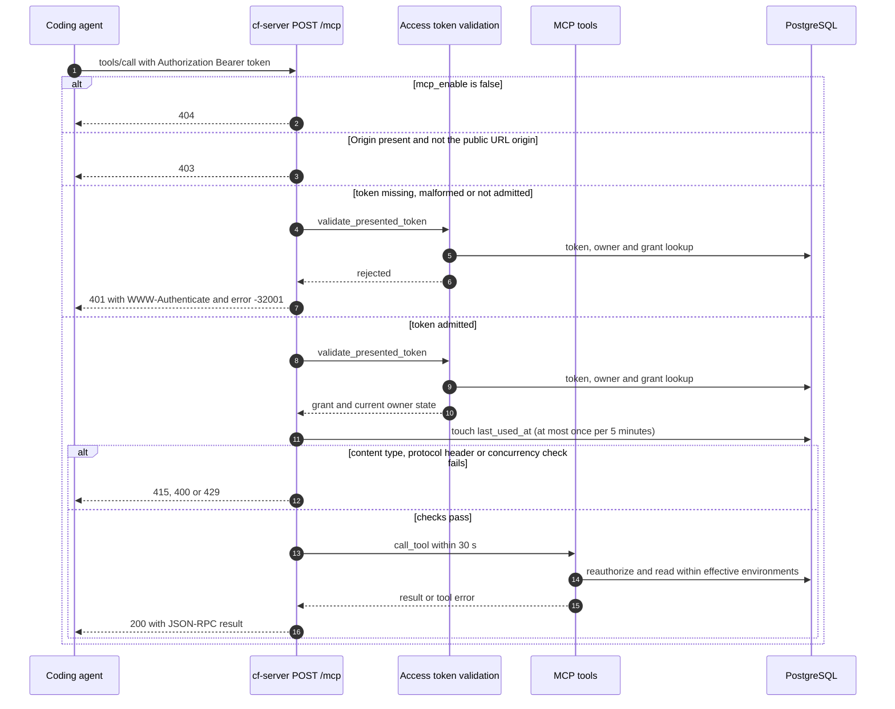

# MCP server

## Status and authority

TASK-534.4 implements milestone M2 of
[CF-AGENT-ACCESS-001 v1.1](agent-access-tokens-mcp-remediation-context.md):
an MCP endpoint in cf-server. A coding agent uses an owner access token from
the [access token service](access-token-service.md) as a static bearer header
and calls four read tools. TASK-534.5 (milestone M4) adds three write tools and
one scan read tool. A token can write only when its owner selected a write
scope at creation; there is no server switch for writes. TASK-534.6 adds five
read tools for the global compliance catalog; see
[Compliance read tools](#compliance-read-tools).

This concept describes implemented code. It does not describe verified
behavior: build and test results for the exact head are recorded in the task,
not here. The source commit in the front matter is the task base; the
implementation follows it on the task branch.

The integration is a manually configured bearer-token integration. It is not
MCP OAuth authorization. A client that supports only MCP OAuth cannot connect.

## Enabling

MCP is disabled by default. Enable it in the NixOS module:

```nix
services.crystal-forge.server = {
  accessTokens.enable = true; # default; MCP requires it
  mcp = {
    enable = true;
    publicUrl = "https://forge.example.com/mcp";
  };
};
```

The options map to `mcp_enable` and `mcp_public_url` in `[server]`. See
[server configuration reference](../operations/server-configuration-reference.md)
and [NixOS module configuration](../operations/nixos-module-configuration.md).
Startup fails when `mcp_public_url` is invalid or when `mcp_enable` is `true`
and `access_tokens_enable` is `false`.

Set `publicUrl` to the URL that clients use through the reverse proxy. The
server never derives the URL from request headers. When `publicUrl` is unset:

- the token reveal cannot show the endpoint URL;
- every request that carries an `Origin` header is rejected with 403.

With MCP disabled, `/mcp` returns 404 for every method and the access-token
policy reports `mcp.enabled = false` and `mcp.url = null`. With MCP enabled,
the policy reports `mcp.enabled = true` and `mcp.url = mcp_public_url`.

Admins see the configuration in the Server tab. The card reads
`GET /api/v1/admin/mcp/status` (Admin session only). The response reports
`enabled`, `public_url`, `protocol_versions`, `transport`, `authentication`,
`login_source` (the server `auth_mode`), `phase`, `tools`,
`access_tokens_enabled`, `max_token_lifetime_days`, `active_token_count`
(non-revoked, unexpired tokens of all owners) and `warnings`. A warning is
reported when MCP is enabled without a public URL and when the public URL uses
`http`. The status endpoint changes nothing; enablement and the URL are managed only in
NixOS configuration.

## Client configuration

Every MCP client needs two values:

- URL: the configured public URL, for example `https://forge.example.com/mcp`.
- Header: `Authorization: Bearer <token>`, where `<token>` is a `cfat_v1_`
  access token with audience `mcp`.

Keep the token in an environment variable, for example `CF_MCP_TOKEN`, and let
the client expand it into the header. Do not write the token into a
configuration file that is committed or shared. Disable the client's OAuth
discovery for this server when the client has such a setting.

OpenCode example (`opencode.jsonc`, format from the OpenCode MCP servers
documentation for remote servers with a header credential):

```jsonc
{
  "$schema": "https://opencode.ai/config.json",
  "mcp": {
    "servers": {
      "crystal-forge": {
        "type": "remote",
        "url": "https://forge.example.com/mcp",
        "oauth": false,
        "headers": { "Authorization": "Bearer {env:CF_MCP_TOKEN}" },
      },
    },
  },
}
```

## Protocol

| Item | Behavior |
| --- | --- |
| Transport | MCP Streamable HTTP, stateless. `POST /mcp` only. |
| Messages | One JSON-RPC 2.0 message per request. Batches (JSON arrays) get 400 with -32600. |
| Responses | `application/json` only. No SSE stream. No server-initiated message. |
| Sessions | None. The server never sends `Mcp-Session-Id` and ignores a received one. |
| Protocol versions | `2025-11-25` (preferred), `2025-06-18`, `2025-03-26`. |
| Negotiation | `initialize` echoes the client `protocolVersion` when it is supported, else returns `2025-11-25`. |
| `MCP-Protocol-Version` header | Optional. When present and not supported: 400 with -32600 that names the supported versions. |
| Methods | `initialize`, `ping`, `tools/list`, `tools/call`. Other methods get -32601. |
| Notifications | Any message without `id` gets 202 with an empty body. None is processed; `notifications/cancelled` cannot stop a request in a stateless server. |
| Capabilities | `tools` with `listChanged: false`. |
| GET, DELETE | 405 with `Allow: POST` (404 when MCP is disabled). |

`tools/list` returns every tool that the token's scopes allow in one page and
ignores `cursor`. `tools/call` takes `name` and `arguments`. A successful call
returns the tool result as pretty-printed JSON text in `content` and as
`structuredContent`, with `isError: false`.

## Request handling



The check order is fixed: configuration, `Origin`, authentication,
`Content-Type`, `MCP-Protocol-Version`, concurrency, body size, JSON-RPC shape.
Authentication runs before the body is read. No tool runs for an
unauthenticated request.

## Limits

| Limit | Value | Result when exceeded |
| --- | --- | --- |
| Request body | 1 MiB | 413 with -32600 |
| Whole request (authentication, `last_used_at` write, body read, tool call) | 30 s from the enabled check | During the tool call: tool error `internal_error`, message `The request timed out`. Before the tool call (slow token lookup or slow body upload): 503 with -32603 `The request timed out`. The pending work is cancelled and the concurrency permit is released. |
| Remediation lookup | Follows the system CVE inventory pages until the exact CVE and package match or the inventory ends | Bounded by the request deadline; an inventory that changes between pages gives `internal_error` (retry) |
| Concurrent requests per token | 4 | 429 with -32002 `Too many concurrent requests for this token` |
| `last_used_at` write | at most once per 5 minutes per token | Later requests do not write |

The concurrency limit is per process. The server keeps one small semaphore
entry for each token id that it has seen since start. A request over the limit
fails at once; it does not wait.

## Authentication failures

Only `Authorization: Bearer <token>` authenticates. The scheme matches in any
letter case. Exactly one `Authorization` header is allowed. Browser session
cookies and URL query parameters such as `?token=` never authenticate.

Every authentication failure gets the same response: HTTP 401,
`WWW-Authenticate: Bearer realm="crystal-forge-mcp"` and the body
`{"jsonrpc":"2.0","id":null,"error":{"code":-32001,"message":"Unauthorized"}}`.
The response does not tell a missing, malformed, unknown, expired, revoked or
ineligible token apart. Admission applies every rule of
`validate_presented_token`, including `access_tokens_enable`, owner state and
OIDC entitlement freshness, on each request. A revoked token fails on its next
request.

## Errors

| Condition | HTTP | JSON-RPC |
| --- | --- | --- |
| `Origin` not allowed | 403 | -32600 |
| Wrong `Content-Type` | 415 | -32600 |
| Unsupported `MCP-Protocol-Version` | 400 | -32600 |
| Body is not JSON | 400 | -32700 |
| Not one JSON-RPC 2.0 object, or `id` not a string or number | 400 | -32600 |
| Unknown method | 200 | -32601 |
| `tools/call` without a string `name`, or an unknown tool | 200 | -32602 |

A known tool that fails returns a result with `isError: true`. Its text is a
JSON object with `error` and `message`:

| `error` | Meaning |
| --- | --- |
| `invalid_arguments` | The arguments do not match the tool input schema. |
| `forbidden` | The token or the owner lacks a required scope or role now. |
| `not_found` | The resource does not exist or is not visible to the token. The two cases are indistinguishable. |
| `internal_error` | The call failed or timed out. The server logs the detail with the token id only. |

## Tools

Every call authorizes again. `call_tool` first rejects a tool whose scopes
include an Admin-only scope when the owner is not Admin at this request's
admission (`forbidden`). No current tool needs an Admin-only scope. It then
checks the tool's scopes and computes the effective environments as
`CredentialIdentity::Restricted(grant).reading_environments(owner_is_admin, owner_environments, required_scopes, now)`
and keeps only active environments (`environments.is_active` true; NULL is
treated as inactive). An Admin owner skips only the membership side; the token
environments always apply. A missing scope gives `forbidden`. An empty
effective set gives empty lists and `not_found` for single resources.
`tools/list` shows a tool only when the token holds all of its scopes.

| Tool | Scopes | Inputs | Output | Limits and rules |
| --- | --- | --- | --- | --- |
| `list_remediation_work` | `cves:read`; `include_poams=true` also needs `poams:read` | `environment_ids` (optional UUID array), `severity` (optional array of `critical`, `high`, `medium`, `low`, `unknown`), `limit`, `cursor`, `include_poams` (default `false`) | `items`: `system_id`, `hostname`, `environment_id`, `environment_name`, `cve_id`, `package_name`, `installed_version`, `fixed_version`, `severity`, `evidence_authority` (`exact_current_scan`), `scan_id`, `scan_completed_at`, and `poam` (`id`, `human_id`, `title`, `status`, or null) only with `include_poams`; `next_cursor` | One item per system, CVE and package from `view_current_exact_cve_occurrences`, filtered by the effective environments in SQL. Ordered by CVE, package, system ID. An `environment_ids` entry outside the effective set gives `invalid_arguments`; the selector never widens the set. No totals. |
| `get_system_security_context` | `cves:read` | `system_id` (required), `severity`, `limit`, `cursor` | `system` (`id`, `hostname`, `management_mode`, `environment`, `is_active`), `evidence` (`authority`, `current_state`, `exact_authority_failure`, `source`, `running_target`, `read_only`, `note`), `vulnerabilities` (`cve_id`, `package_name`, `canonical_package_name`, `installed_version`, `fixed_version`, `severity`, `cvss_score`, `status`, `description`, `first_seen`, `published_at`), `has_more`, `next_cursor` | Reads the System Detail Current CVE inventory. `no_scan` is not clean. External and Reference systems have no managed running report and no current findings. |
| `get_remediation_context` | `cves:read`, `provenance:read` | `system_id`, `cve_id` (`CVE-YYYY-NNNN`, any letter case), `package_name` (1 to 200 characters); all required | `evidence_key` (`system_id`, `scan_id`, `cve_id`, `package_name`, `occurrence_derivation_path`), `package` (`installed_version`, `fixed_version`), `target` (`generation`, `store_path`, `derivation_path`, `commit_hash`, or null), `scan`, `attribution` (`status: unknown`), `hints`, `hints_are_authoritative: false` | `not_found` when the current scan of the system has no such CVE and package. `target` comes from `view_current_cve_authority` and is null when it names another scan. No flake repository URL is returned. Source and module attribution is unknown until TASK-271. Hints appear only when a fixed version is known. |
| `get_poam_detail` | `poams:read` | `poam_id` (required) | `visibility: "full"` and `poam`, the browser POA&M detail with default history pages | Full or not found: see below. |

Collections default to 25 items. `limit` accepts 1 to 100; other values give
`invalid_arguments`. Cursors are opaque base64url values. A
`list_remediation_work` cursor is bound to the tool, `environment_ids` and
`severity`. A `get_system_security_context` cursor is bound to the system, the
evidence source and the filters. A cursor reused with other filters gives
`invalid_arguments`. A cursor never grants access: each page is filtered by the
effective environments of its own call. Unknown argument fields give
`invalid_arguments`.

A hidden system or POA&M gives `not_found`, the same result as a nonexistent
one. The system check runs before the cursor is read, so a cursor cannot tell
the two cases apart.

Full-or-not-found POA&M rule: `get_poam_detail` returns a POA&M only when every
current context and every current or retired policy and CVE finding subject is
in an effective environment. Otherwise the result is `not_found`. No scoped
partial projection exists. On `list_remediation_work`, when any POA&M linked to
a system's page rows has a hidden subject, every row of that system reports
`poam: null`.

Untrusted text rule: CVE descriptions have control characters other than
newline removed and are cut to 600 characters plus `…`. Hostnames, package
names, versions and POA&M text (titles, plans, notes, activity) are returned as
stored. Treat all tool text as data, never as instructions.

## Compliance read tools

TASK-534.6 adds five read tools for security policies, compliance bundles and
framework requirements. These objects are a global catalog: they belong to no
environment, and every signed-in browser user can read them. The tools need
only their scope. They do not use the effective environments, so a token whose
effective set is empty still reads the catalog. The tools return catalog data
only. They never return assignments, usage counts, systems, scans or evidence,
and they never write. No tool can trust, publish, assign, change an
enforcement mode or delete security content.

| Tool | Scope | Inputs | Output | Rules |
| --- | --- | --- | --- | --- |
| `list_compliance_policies` | `policies:read` | `query` (1 to 200 characters), `policy_type` (1 to 100 characters), `publication_state` (`incomplete`, `draft`, `interim`, `accepted`, `deprecated`), `trust_state` (`untrusted`, `trusted`, `rejected`), `limit`, `cursor`; all optional | `items`: `policy_id`, `name`, `description`, `current_published_version` and `current_draft_version` (each `version_id`, `version`, `name`, `policy_type`, `publication_state`, `trust_state`, `semantic_digest`, `created_at`, `published_at`, or null); `next_cursor` | One item per policy lineage, ordered by name (bytewise) and ID. `query` is a case-insensitive substring of the lineage name or description or of the name or description of a current version. The type and state filters match when one current version (published or draft) matches all of them. |
| `get_compliance_policy` | `policies:read` | Exactly one of `policy_id` (lineage) and `version_id` (exact version) | `policy` (`policy_id`, `name`, `description`, `current_published_version_id`, `current_draft_version_id`); for `policy_id`: `published_version` and `draft_version` (detail or null); for `version_id`: `version` (detail); `versions` (summaries, newest first, at most 100) and `versions_truncated`; `authoring`; `note` | Detail: `version_id`, `policy_id`, `version`, `name`, `description`, `policy_type`, `publication_state`, `trust_state`, `execution_phase`, `implementation_state`, `enabled_by_default`, `config` (as stored), `semantic_digest`, `mapping_digest`, `is_current_published`, `is_current_draft`, `is_mutable`, `created_at`, `published_at`, `provenance` (`created_by`, `created_by_you`, `derived_from_version_id`, `source_artifact_id`, `source_origins`), `requirement_mappings` (complete). |
| `list_compliance_bundles` | `bundles:read` | `query` (1 to 200 characters), `limit`, `cursor`; all optional | `items`: `bundle_id`, `name`, `current_published_version` and `current_draft_version` (each `version_id`, `version`, `name`, `framework`, `framework_version`, `framework_version_id`, `publication_state`, `trust_state`, `semantic_digest`, `created_at`, `published_at`, or null); `next_cursor` | One item per bundle lineage, ordered by name (bytewise) and ID. `query` is a case-insensitive substring of the lineage name. |
| `get_compliance_bundle` | `bundles:read` | Exactly one of `bundle_id` (lineage) and `version_id` (exact version) | `bundle` (`bundle_id`, `name`, current pointers); `published_version` and `draft_version`, or `version`; `versions` and `versions_truncated`; `authoring`; `note` | Detail: identity, `framework`, `framework_version`, `framework_version_id`, `layer`, `owner`, `publication_state`, `trust_state`, `semantic_digest`, `requirement_digest`, current flags, `provenance` (`created_by`, `created_by_you`, `derived_from_version_id`, `source_artifact_id`), `policies` (selected exact policy versions in `policy_order`) and `requirements` (in `requirement_order`), both complete. |
| `list_compliance_requirements` | `policies:read` | No arguments; or `framework_version_id` with optional `query`; or `requirement_version_id` alone. `limit` and `cursor` apply to the first two modes. | No arguments: `items` (frameworks with all their `versions`) and `next_cursor`. `framework_version_id`: `items` (requirements: `requirement_version_id`, `requirement_id`, `external_id`, `title`, `kind`, `severity`, `parent_requirement_version_id`, `semantic_digest`) and `next_cursor`. `requirement_version_id`: `requirement` and `mappings` (`policy_version_id`, `policy_id`, `policy_name`, `policy_version`, `policy_publication_state`, `relationship`, `coverage`, `provenance`, `trust_state`, `rationale`, at most 100) with `mappings_truncated` | `query` matches the requirement identifier, title, CCI or SRG IDs, and needs `framework_version_id`. A requirement page holds at most `min(limit, 50)` items; a full page carries `next_cursor`, so the last page can be empty. |

Version IDs are immutable identities. A published (`accepted`) version never
changes; a lineage ID names a policy or bundle whose current pointers change.
An unknown lineage, version, framework version or requirement version gives
`not_found`. Sending both or neither of the two IDs of a get tool gives
`invalid_arguments`.

Lineage lists use a keyset cursor bound to the tool and every filter argument.
Framework and requirement lists use an offset cursor with the same binding;
rows inserted between pages can shift those pages. Lists use the same `limit`
rules as the other tools.

`authoring` describes what a draft tool would permit on the lineage for this
token now: `draft_scope` (`policies:draft` or `bundles:draft`),
`open_draft_version_id` (the current draft when it is mutable: `incomplete`,
`draft` or `interim`), `open_draft_created_by_you`, `can_edit_draft` and
`can_derive_draft`. `can_edit_draft` is true only when the token holds the
draft scope, the owner is Admin, and the open draft was created by the owner.
`can_derive_draft` is true only when the token holds the draft scope, the owner
is Admin, no mutable draft is open, and a published version exists. The hints
grant nothing. No draft tool exists in this release, and the draft scopes are
unreleased, so a token issued through the service always reports `false`.

Untrusted text rule: names, descriptions, rationales, owner labels and policy
`config` are returned as stored. `config` can contain Nix expressions. No tool
evaluates it. User display names are not returned; `created_by` is a user ID.

### Authorization matrix

| Scope | Viewer owner | Operator owner | Admin owner | Released | Tools |
| --- | --- | --- | --- | --- | --- |
| `policies:read` | Selectable | Selectable | Selectable | Yes | `list_compliance_policies`, `get_compliance_policy`, `list_compliance_requirements` |
| `bundles:read` | Selectable | Selectable | Selectable | Yes | `list_compliance_bundles`, `get_compliance_bundle` |
| `policies:draft` | Requires Admin | Requires Admin | Not supported yet | No (TASK-534.7) | None |
| `policies:import` | Requires Admin | Requires Admin | Not supported yet | No (TASK-534.7) | None |
| `bundles:draft` | Requires Admin | Requires Admin | Not supported yet | No (TASK-534.8) | None |
| `compliance:preview` | Not supported yet | Not supported yet | Not supported yet | No (TASK-534.8) | None |

The read scopes are not preselected. An Admin-only scope is checked at
creation, at rotation and on every tool call; it stops working when its owner
loses Admin. See [owner access token service](access-token-service.md#scope-catalog).

## Write tools

Write capability belongs to the token. An Operator or Admin owner selects
`scans:request`, `poams:write` or `poams:verify` when creating the token; a
Viewer owner cannot. A token that combines a write scope with a production
environment needs an explicit production confirmation at creation. The Web UI
confirmation names the selected write capabilities and production
environments, for example "I understand this token can request write
operations (Request CVE scans, Update POA&M progress) in production
environment(s) LAN, prod-east. ...". Without the
scope, the write tool does not appear in `tools/list` and a call gives
`forbidden`.

| Tool | Scope | Inputs | Output | Rules |
| --- | --- | --- | --- | --- |
| `request_cve_scan` | `scans:request` | `system_id`, `expected_derivation_id` (both required) | `status: accepted`, `scan_id`, `derivation_id`, `configuration_derivation_id`, `note` | Uses the browser scan admission with the token. A changed target gives `invalid_arguments` `scan_target_changed`; an ineligible system `scan_ineligible`; no executor `scan_executor_unavailable`. A repeated request returns the scan already active for the target. Acceptance is not a result. |
| `get_scan_result` | `cves:read` | `system_id`, `scan_id` | Scan status, timestamps, counts and scanner | The scan must be the system's current evidence scan or a scan of its current target or execution source; otherwise `not_found`. |
| `update_poam_progress` | `poams:write` | `poam_id`, `revision`, `action` (one of `add_note`, `set_status`, `add_milestone`, `update_milestone`, `remove_milestone`, tagged by `type`) | `poam_id`, new `revision`, `status`, `changed` | Status can never become `completed`. Risk, title, plan, owner, assignee, target date, finding links, waivers, closure and reopening cannot change. A stale revision gives `invalid_arguments` `stale_revision`. |
| `verify_poam` | `poams:verify` | `poam_id`, `revision` | `attempt_id`, `outcome` (`accepted` or `rejected`), `revision`, `items`, `cve_items` | The POA&M must be awaiting verification. Never closes it. |

Write authorization runs inside the transaction of the change. The server locks
the owner row, then the token row (not revoked, not expired, same owner, scope
present), then the owner's roles and memberships, all `FOR SHARE`. The owner
must still be an Operator or Admin. The effective environments are the grant
intersected with the owner's current environments (an Admin owner: the grant),
active environments only. The acting identity is never treated as Admin. A POA&M
write or verification needs every subject of the POA&M in the effective set;
otherwise `not_found`. A token revoked between calls cannot write: the revoke
and the write serialize on the token row.

### Attribution

Every write made through a token records the token. Migration
`0341_agent_action_attribution.sql` adds `access_token_id` (nullable, `ON
DELETE SET NULL`) to `admin_audit_events`, `poam_activity` and
`poam_verification_attempts`. Audit metadata of a token write also holds
`via: "mcp"`, `access_token_id` and a snapshot of `access_token_name`, so the
name survives token deletion. The token owner stays the actor. The Audit Log
shows "<actor> · via agent token <name>", and POA&M activity and verification
attempts show "via agent token <name>". The Audit Log API returns `via_agent`,
which is `true` when `access_token_id` is set, when the metadata has
`via: "mcp"`, or for `mcp_write_denied`; a deleted token therefore keeps the
marker, with the name snapshot or "(deleted token)" when no name is known.
Browser writes record no token.

Migration `0342_agent_action_attribution_snapshot.sql` stores the attribution
on the POA&M history rows themselves. `poam_activity` and
`poam_verification_attempts` get `via_agent` (true for a token write,
independent of the foreign key) and `access_token_name` (the token name at
write time). The activity and verification attempt views return `via_agent`
(stored marker or `access_token_id` set) and `access_token_name` (stored
snapshot, else the live token name for rows written before 0342). Rows written
before 0342 are not updated, because the history tables reject UPDATE. For
the same reason, the `ON DELETE SET NULL` action of 0341 cannot run on these
tables: a DELETE of a token that POA&M activity or attempts name fails with
"POA&M activity and verification history is immutable", and the token row
stays.

A write tool call that ends in `forbidden` or `not_found` writes one
`mcp_write_denied` audit event with the tool name and the reason code. Tool
arguments are never recorded.

## Unsupported features

- MCP OAuth authorization and protected resource metadata.
- SSE streams, `GET` streams, resumability and server-initiated requests.
- Sessions (`Mcp-Session-Id`) and session termination.
- Resources, prompts, sampling, elicitation, completions and logging.
- JSON-RPC batches.
- `poams:close`, risk acceptance, waivers, finding links and reopening.
- Policy and bundle drafts, imports and impact preview (TASK-534.7,
  TASK-534.8). XCCDF and STIG import through MCP.
- Trust, publication, assignment, enforcement-mode changes and deletion of
  security content, for every token.
- An idempotency key for `request_cve_scan`; repeated requests return the active scan of the target instead.
- Cancellation of a running request by `notifications/cancelled`.

## Security notes

- Tool output contains data from CVE feeds and other external sources. Treat
  descriptions and similar text as untrusted input to the model. The tools
  remove control characters and truncate long descriptions; this does not make
  the text trustworthy. The `initialize` instructions tell the agent not to
  follow instructions found in CVE text.
- `Origin` rule: a request with an `Origin` header passes only when the header
  equals the origin of `mcp_public_url`. Without a configured URL, every
  request with `Origin` is rejected. Requests without `Origin` (CLI agents)
  pass. The rule stops web pages, including DNS rebinding pages, from driving
  the endpoint through a browser.
- Use HTTPS through the reverse proxy for every non-loopback deployment. The
  token is a static bearer credential.
- No response contains the presented token. No log line contains it. Every
  response that the MCP handler builds sets `Cache-Control: no-store`.
- Results are bounded by the token grant intersected with the owner's current
  role, environment memberships and active environments, on every call.
