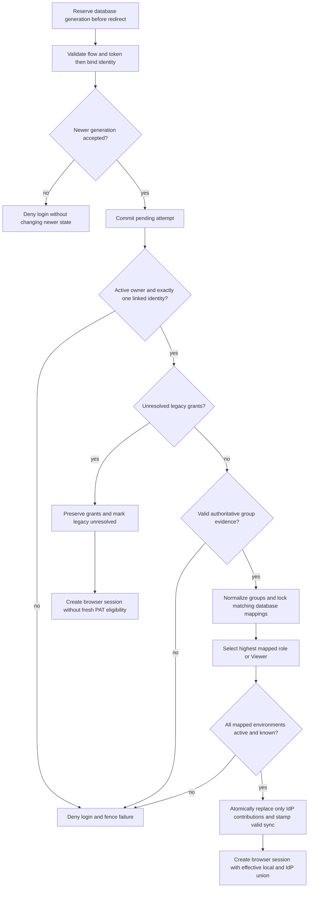

# OIDC Role Mapping Configuration

Crystal Forge maps validated OIDC groups to IdP-owned roles and environment
memberships on login. The mapping lives in **`oidc_group_mappings`**. An Admin
edits it through the Web UI or admin API. Independent local overrides survive
IdP reconciliation. This guide describes implemented source in TASK-529.2;
current-source farm verification is pending. The historical source references
above retain provenance for the earlier guide, not proof of current behavior.
See [OIDC entitlement ownership](oidc-entitlement-ownership.md) for the partial
PAT groundwork and upgrade procedure.

> **Not used:** The environment variables `CRYSTAL_FORGE_ROLE_MAPPING` and `CRYSTAL_FORGE_DEFAULT_ROLE`, and any "safe-deny" behavior that they describe, do not affect login. The file `auth/role_mapping.rs` exists in the source tree, but `auth/mod.rs` does not declare it as a module, so the build does not compile it. Do not set those variables.

## Roles

Three roles exist:

- **Admin**: full system access.
- **Operator**: can manage deployments, builds, and systems.
- **Viewer**: read-only access, limited to the user's environment memberships.

## What happens at login



1. **Validate and order.** The callback validates flow/token evidence and binds
   provider, subject and issuer. It reuses the generation reserved before
   redirect. Older callbacks cannot restore rights or overwrite newer state.
2. **Check compatibility.** Exactly one external identity is supported, counting
   all providers. Multiple linked identities deny login. Unresolved legacy grants
   preserve existing rights and login even if group evidence is missing, but
   remain not fresh. Binding, activity and generation checks still apply.
3. **Read groups for managed reconciliation.** The `roles_claim` setting defaults
   to `groups`. Arrays must contain only strings; single/comma-separated strings
   and dotted paths such as `realm_access.roles` are supported. An empty array or
   blank string is valid empty evidence. Missing, null or malformed evidence
   denies managed login with HTTP 403; it is not an empty successful mapping.
4. **Normalize and match.** Trim and ASCII-lowercase groups, drop empty values,
   then match normalized `oidc_group_mappings.group_name` values.
5. **Replace managed rights.** Select the highest mapped role: Admin, Operator,
   otherwise Viewer. Replace only this identity's IdP contributions. No matched
   role means OIDC-owned Viewer, not retention of the previous managed role.
   See [Environment memberships](#environment-memberships).
6. **Commit then issue the session.** Managed grants, claims and successful sync
   time commit atomically before session creation. Failure rolls back that
   transaction and leaves fenced invalid/pending freshness. Local rights survive.

**Removed groups.** Valid empty groups or no matching mappings remove obsolete
IdP rights and yield managed Viewer with no managed environments. Effective
rights still include local overrides. An Admin's explicit reassignment creates
a local override; later IdP group removal does not revoke it. The last-Admin
guard cannot retain revoked IdP Admin rights, so plan independent recovery before
cutover: final IdP Admin removal can leave zero Admins.

## Mapping records

Each row of `oidc_group_mappings` has:

| Column | Meaning |
| --- | --- |
| `group_name` | Normalized group name. Unique. |
| `role` | `admin`, `operator`, `viewer`, or empty. An empty role contributes no role; if no match contributes Admin or Operator, managed role defaults to Viewer. It may still map environments. |
| `environments` | Environment names for membership. May be empty. |

A group name has at most 128 characters. It may contain only letters, numbers, `-`, `_`, `.`, `:`, and `/`. **A group name with a space is invalid.** The server stores the name in lower case.

### Manage mappings

An Admin uses these routes (see [Builders, queues, environments, dashboard, and admin APIs](../api/builders-queues-environments-dashboard-admin-api.md)):

- `GET /api/v1/admin/oidc-mappings` lists mappings.
- `POST /api/v1/admin/oidc-mappings` creates or updates a mapping by `group_name`. The body is `{"group_name": "...", "role": "operator", "environments": ["staging"]}`. Every environment name must exist.
- `DELETE /api/v1/admin/oidc-mappings/:id` deletes a mapping.

Each change writes an audit event.

### Bootstrap admin group

The NixOS option `services.crystal-forge.server.oidc.bootstrapAdminGroup` sets `CRYSTAL_FORGE_OIDC_BOOTSTRAP_ADMIN_GROUP`. When `auth_mode` is `oidc`, the server creates a mapping from that group to Admin at start, with no environments. The server trims and lowercases the name. If a mapping for the group exists, the server leaves it unchanged. Use this setting to get the first administrator without editing the database.

## Environment memberships

A mapping can list environment names. A successful managed reconciliation
replaces this identity's entire environment contribution with the normalized,
deduplicated union from current matching mappings. No matches or no environment
names means **no managed memberships**. Independent local memberships survive,
including overlap on the same effective row.

Every mapped environment must exist and be active. Unknown or inactive names
deny reconciliation and login; rollback is not a successful preserve-old-access
fallback. Unresolved legacy grants use the separate compatibility path above
until explicit category-by-category classification.

## Configuration

Configure the OIDC client with the NixOS options under `services.crystal-forge.server.oidc`. The claim that holds groups has this option:

- `rolesClaim`: sets `CRYSTAL_FORGE_OIDC_ROLES_CLAIM`. The default is `groups`.
- `entitlementMaxAgeSeconds`: sets
  `CRYSTAL_FORGE_OIDC_ENTITLEMENT_MAX_AGE_SECONDS`. Default 86400 (24 hours),
  integer range 1 through 4294967295 seconds. This bounds future OIDC-owned PAT
  eligibility, not existing browser session TTL. The helper is not yet wired to
  PAT admission; see [freshness policy](oidc-entitlement-ownership.md#freshness-policy-and-future-pat-boundary).

Microsoft Entra ID commonly sends app roles in the `roles` claim, so set `rolesClaim = "roles"` for Entra. Keycloak can send nested realm roles in `realm_access.roles`.

## Role synchronization

The server applies mappings **on every login**. A group change takes effect at the user's next login, not in real time. The user must sign out and sign in again.

## Examples

### Keycloak with top-level groups

```nix
services.crystal-forge.server.oidc = {
  rolesClaim = "groups";
  bootstrapAdminGroup = "cf-admins";
};
```

Then add mappings through the admin API (the group names are lower case):

```bash
curl -X POST "$CF_URL/api/v1/admin/oidc-mappings" \
  -H "Content-Type: application/json" \
  -H "x-csrf-token: $CSRF" \
  --cookie "__Host-cf-session=$SESSION; __Host-cf-csrf=$CSRF" \
  -d '{"group_name": "cf-operators", "role": "operator", "environments": ["staging"]}'
```

### Microsoft Entra ID

```nix
services.crystal-forge.server.oidc = {
  rolesClaim = "roles";
  bootstrapAdminGroup = "CrystalForge.Admins";  # stored as crystalforge.admins
};
```

### Authentik

A group named `authentik Admins` contains a space and cannot be a mapping name. Rename the group in the identity provider, for example to `authentik-admins`, or send a different claim value.

## Testing role mapping

1. Log in with OIDC.
2. Check the effective role and memberships through existing admin controls and
   review login/reconciliation logs. Do not log raw identity claims or secrets.
3. In an approved isolated rehearsal, verify source flags and sync state as well
   as effective rights. Effective rights alone do not prove IdP ownership or
   freshness. Follow the [upgrade procedure](oidc-entitlement-ownership.md#one-time-upgrade-procedure)
   before classifying existing accounts. Current-source farm execution remains
   pending; a manual login is not full M0 acceptance evidence.

## Troubleshooting

**The user signs in as Viewer and sees nothing**
- Valid empty groups or no matching mapping produces managed Viewer without
  managed environments. Missing/malformed groups instead deny managed login.
- Check that the provider sends the claim, and that `rolesClaim` names it.
- Check that `oidc_group_mappings.group_name` equals the lower-case group value.

**The role does not update after a group change**
- Roles update on login. The user must sign out and sign in.
- Check independent local overrides or unresolved legacy ownership. Removed
  managed groups lower managed authority on successful reconciliation; local
  overrides survive until explicitly removed.

**Environment access does not change**
- Every mapped environment must exist and be active; otherwise login fails and
  freshness does not advance. Check local overlap and unresolved ownership if
  effective memberships survive a successful empty managed replacement.

**Login fails after upgrade**
- Check group claim shape, active mapped environments, owner/identity binding,
  stale flow generation and multiple linked identities. The legacy compatibility
  path does not support multi-identity linkage. Use the preverified recovery path
  rather than retaining revoked IdP privileges or fabricating a successful sync.

## Related concepts

- [Session cookies and CSRF](session-cookies-and-csrf.md): the session created after a successful login.
- [OIDC entitlement ownership and freshness](oidc-entitlement-ownership.md): source union, locking, failure fencing and upgrade runbook.
- [OIDC provider compatibility validation](oidc-provider-compatibility-validation.md): provider claim shapes tested against role extraction.
- [API authentication, sessions, and role-based authorization](api-authentication-and-authorization.md): roles and environment scoping.
