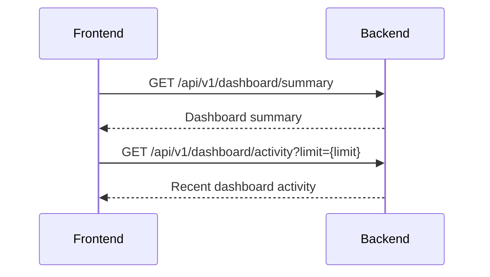
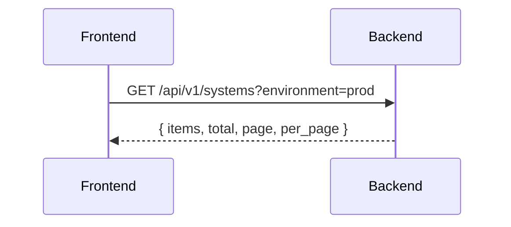
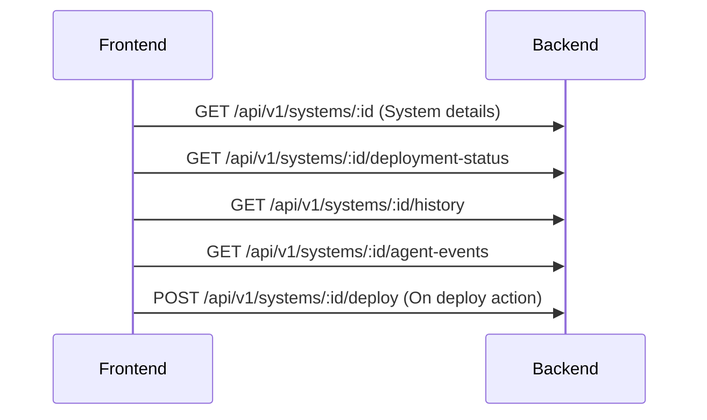

# Dashboard and systems views

**TASK-508 status: partial.** Mode-aware DTOs, forms and evidence/runtime views
are being implemented against the approved management-mode design in
`docs/design/CrystalForge` at `18b47eed`. Final browser/design comparisons and
owning integration results are pending. The runtime workflow descriptions below
apply to managed machines. External/reference views use configuration evidence;
reference is not an online/offline machine. See
[management modes](../concepts/management-modes-and-configuration-assurance.md)
for neutral unknown health, artifact admission and remaining integration proof.

## Dashboard (`/`)

**Route:** `/`

**Purpose:** Give users a quick overview of their fleet without having to click around.

### What It Shows

1. **Fleet Summary Card**
   - Active managed-machine total
   - Managed health partition, including offline
   - Environment registry count is separate from managed operational rollups

2. **Build Queue Widget**
   - How many builds are pending
   - How many are currently building
   - Recent build activity (last 5 builds)

3. **Flake Timeline Widget**
   - Recent commits across all tracked flakes
   - Shows commit message, author, time
   - Clicking a commit takes you to that flake

4. **Quick Actions**
   - "Deploy New System" button
   - "Sync All Flakes" button
   - Links to common tasks

### Data Flow

### How to Modify

- **Backend:** Modify `handlers/api/dashboard.rs`
- **Frontend:** Modify `views/dashboard.rs`

## Systems List (`/systems`)

**Route:** `/systems`

**Purpose:** See all registered systems at a glance, filter them, and navigate to specific systems.

### What It Shows

1. **View Toggle**
   - **Cards View:** Visual cards with system info (default)
   - **Table View:** Compact table for many systems

2. **Filter Controls**
    - **Environment Dropdown:** Filter by prod/staging/dev
    - **Management mode:** Managed / External / Reference; server filter applies before totals and pagination
    - **Health:** Managed health categories; nonmanaged evidence is separate
    - **Tags:** Exact tag filter with counts from the loaded authorized fleet
    - **Search Box:** Filter by name, hostname or case-insensitive tag text

3. **System Cards/Rows**
   Each card shows:
   - System name (bold)
   - Hostname (subtitle)
   - Environment badge (colored)
    - Managed machine health and heartbeat; nonmanaged evidence status is separate
    - Configuration identity and management mode
    - Managed deployment state or nonmanaged deployment-unavailable explanation
    - Nonmanaged cards show Configuration (`flake#configuration`), Revision
      (short SHA and branch), Evidence (`scanned <age>` or `not scanned`) and
      Runtime (`Not a running machine`, `Runtime unknown` or the latest
      parent-reported unit state), plus a single **Evidence** action

4. **Stat strip**
   Managed, Healthy, Warning/drift and Critical/offline count active managed
   machines only. **CVEs (critical)** totals critical CVEs "across N scanned
   resources": managed machines contribute current runtime evidence; external
   and reference resources contribute their latest sealed configuration scan.
   A resource without sealed evidence contributes nothing; it is not counted as
   clean.

### User Interactions

| Action | Result |
|--------|--------|
| Click card | Navigate to System Detail |
| Click environment badge | Filter list to that environment |
| Click "Deploy" | Open deployment modal |
| Click "Add System" | Open add system modal |

Add/edit forms persist tags and description/notes in every mode. Tags have live
authorized-fleet suggestions and chips. Managed forms also persist address and
reachability. Omitted edit fields preserve stored values; see the
[Systems API](../api/systems-api.md) for clear/reset semantics. The fleet adapter
loads all server pages when no explicit page is requested, so client filters,
tag scopes, suggestions and counts are not limited to page one. A failed
continuation reports an error rather than presenting a partial fleet as complete.
Explicit page requests retain server pagination.

The forms store only the existing `manual`, `auto_latest` and `pinned` policies.
Add offers `inherit` (the default, per the approved design) and Edit offers
**Environment default**. Both send `environment_default`; the server copies the
environment's current default when saved. The help text states that later
environment-default changes do not update the system, and Edit always reopens
with the stored concrete policy. Initial managed conversion requires fresh
credentials and manual policy.

When Edit selects `pinned`, it shows the approved pinned-commit list from the
same System Detail commit list. Saving a changed selection sends
`pinned_commit`; it is metadata and never requests a deployment. Add keeps the
design's "set the pin from System Detail after registering" guidance.

### Data Flow

**Query Parameters:**
- `?environment=prod` - Filter by environment
- `?management_mode=external` - Filter registered management authority
- `?health_status=healthy` - Filter by managed health category
- `?search=web` - Search name/hostname
- `?tag=edge` - Exact persisted tag filter

### How to Modify

- **Backend:** `handlers/api/systems.rs`, `queries/systems.rs`
- **Frontend:** `views/systems_list.rs`, `systems/adapter.rs`

## System Detail (`/systems/:id`)

**Route:** `/systems/:id` (e.g., `/systems/abc-123`)

**Purpose:** Manage a single system - deploy, rollback, view history.

For external/reference resources, Overview/History present exact revision,
evaluation, build and scan evidence. Deploy explains that CF has no authority;
runtime deployment logs are unavailable. Config browsing does not invent a
running generation. Evidence CVE/hardening/compliance views cannot enable runtime
triage, remediation verification or POA&M closure from artifact evidence.
The CVE tab requires an exact sealed CVE scan. Hardening uses exact derivation
and build history independently: a missing or failed CVE scan does not hide a
hardening assessment. Missing hardening evidence is unavailable, not a clean
result. Compliance likewise selects captured evaluation-attempt evidence rather
than treating CVE scan completion as its authority.
External runtime shows only stored parent reports; reload calls the latest
observation API and keeps the last report on request failure. Reference has no
runtime health card. These are the TASK-508 contract and inspected source paths,
not a claim that every affected tab has passed final UI verification.

Configuration Re-scan sends the displayed artifact's expected derivation ID to
the scoped system endpoint. A changed eligible target returns 409 and queues no
replacement; pending intent is not scan execution. Inactive managed detail keeps
mode/epoch-filtered telemetry under migration `0320`; registry deactivation alone
does not mean offline and does not preserve Current CVE/POA&M authority.

### Layout (Tabs)

The view has **tabs** for different aspects:

#### Tab 1: Overview (`/systems/:id?tab=overview`)

**Purpose:** See current system state at a glance.

**Shows:**
- System name and hostname
- Environment badge
- Status (online/offline, last heartbeat)
- NixOS version
- Currently deployed flake + commit
- Currently activated generation number

#### Tab 2: Deploy (`/systems/:id?tab=deploy`)

**Purpose:** Deploy a new configuration to this system.

**Components:**
1. **Flake Selector** - Dropdown to pick a flake
2. **Branch Selector** - Pick branch (main, prod, etc.)
3. **Commit Selector** - Pick commit (shows commit message + date)
4. **Diff Viewer** - Shows what files changed (optional)
5. **Deploy Button** - Triggers deployment

**User Flow:**
1. User selects flake
2. User selects branch
3. User selects commit
4. (Optional) User clicks "Show Diff" to see changes
5. User clicks "Deploy"
6. Modal shows progress
7. Success/failure notification

#### Tab 3: History (`/systems/:id?tab=history`)

**Purpose:** See past deployments to this system.

**Shows:**
- Table of deployments
- Columns: Date, Commit, Status (success/failed), Triggered By
- Click row to see deployment details

#### Tab 4: Logs (`/systems/:id?tab=logs`)

**Purpose:** See deployment output logs.

**Shows:**
- Scrollable log output
- Timestamps
- Filter by deployment (select from dropdown)

### Data Flow

### How to Modify

- **Backend:** `handlers/api/systems.rs`
- **Frontend:** `views/system_detail.rs`, `components/system/`

The System Detail page has one UI route, `/systems/:id`. Its tabs use the
`tab` query parameter; the route also carries `poam`, `config_mode`, `revision`,
`generation`, `deploy_generation`, `cve_target`, and `cve_mode`. API paths in
the data flow are server routes, not UI routes.

## Related concepts

- [Web UI navigation, shared components, responsive behavior, and structure](frontend-navigation-and-shared-patterns.md)
- [Flakes, environments, builds, and evaluations views](flakes-environments-builds-and-evaluations-views.md)
- [Systems API](../api/systems-api.md)
- [Builders, queues, environments, dashboard, and admin APIs](../api/builders-queues-environments-dashboard-admin-api.md)
